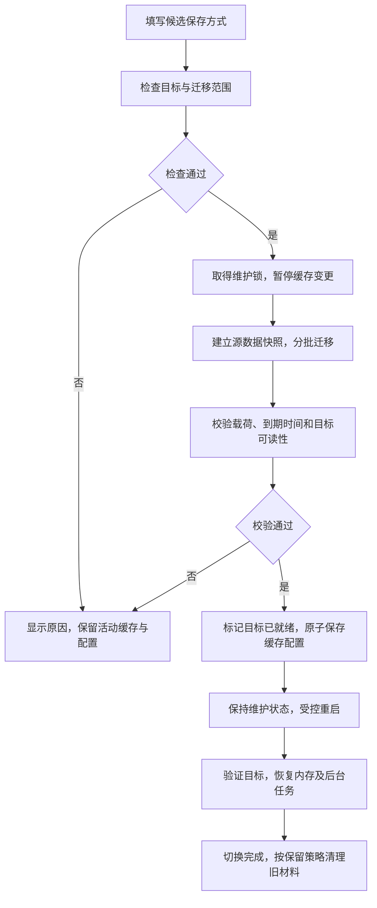
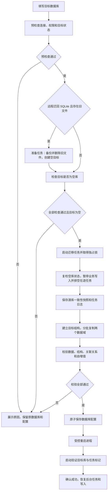

# 缓存优化与多数据库重构方案

编制日期：2026-10-12。后端基线：`version.py` 的 `v3.1.12`；前端基线：`package.json` 的 `2.0.9`。

后端目录：`/home/coolkid/code/nas-tools`；前端目录：`/home/coolkid/code/nas-tools-web`。下文后端路径相对后端根目录，前端路径以 `前端/` 标注。

本文件记录实施和验收状态，代码注释和网页页面文字描述均使用中文。复选框仅在有实现或测试证据时勾选。2026-10-13 已在隔离 PostgreSQL、MySQL、MariaDB 测试库上运行数据库契约和空库 schema 初始化，测试库已清理；版本、耗时和未覆盖边界见 [docs/database-storage.md](docs/database-storage.md)。


## 1. 目标与交付边界

- [x] 缓存：除登录壁纸外，取消应用层缓存条数、总容量、单条容量限制，包括 AI 解析、识别证据、TMDB、搜索、令牌和配置加载缓存。
- [x] 保留登录壁纸现有 `maxsize=2`，并将其修改为 `maxsize=1`、TTL、刷新及清理行为；其他缓存保留有效期、主动失效、手动清理和统计。
- [x] 同步修改前端缓存管理页面、AI 缓存设置、接口类型和帮助文案；数据库与缓存页面统一设计桌面、平板和移动端交互，设计详见第 7.3～7.6 节。
- [x] 本地持久化缓存统一使用固定的 `<配置文件目录>/cache/system.sqlite3`，与业务数据库 `db/nastools.db` 分离；缓存切换严格先检查、迁移和校验数据，再保存配置并受控重启。
- [x] 将旧 `cache/files/` 及旧 SQLite 缓存转换到新缓存存储，接管迁移完成状态后删除多余的 `cache/migrations/`，防止重启后重复导入已清理的数据。
- [x] 数据库：采用统一接口与后端实现，业务调用不区分 SQLite、PostgreSQL、MySQL、MariaDB。
- [x] 后端数据库默认使用 SQLite，将 `user.db`、`media.db` 合并为 `<配置文件目录>/db/nastools.db`；保存路径固定，由后端计算，不提供目录修改配置、接口参数或前端输入。
- [x] 版本升级时自动将旧配置目录根部或 `db/` 下的双库迁移合并为 `db/nastools.db`，覆盖 WAL 数据、结构升级、完整性校验、重复启动和中断恢复，全部成功后才启动数据库业务。
- [x] SQLite 提供整库手动“回收空间”功能，统一处理 `nastools.db`，展示预计可回收空间和执行前后实际占用。
- [x] 合库统一连接池、metadata、事务和结构版本，并按实际低频媒体同步场景实现分批代次发布；性能验收与调优见第 8 节。
- [x] 在系统设置新增“数据库”标签，展示实际使用的数据库、连接状态、结构版本、记录数和占用空间。
- [x] 支持检查目标数据库、迁移数据、校验数据、保存配置、重启和启动后确认的完整切换流程。
- [x] 数据库迁移必须以空库为目标：目标不能已有用户表、数据或应用结构版本；从 PostgreSQL/MySQL/MariaDB 迁回 SQLite 时，先备份并删除旧 SQLite 文件，创建空目标，再迁入当前源库数据，不与旧 SQLite 内容合并。
- [x] 支持完整数据库压缩备份下载，以及备份上传、校验、恢复；同一备份格式可用于四种数据库。
- [x] 缓存修改和数据库重构分阶段交付；数据库管理页面在迁移及恢复服务实现后接入。分别回归见第 8 节。

“取消容量限制”指取消应用主动的容量淘汰和拒绝缓存逻辑，不取消 TTL，也不修改 Redis/Valkey 服务端资源策略。AI 执行超时、并发控制、请求分页、搜索任务队列、识别记录保留策略属于其他功能，维持原有语义。

## 2. 已确认的现状与关键改造点

| 范围 | 当前实现 | 改造要求 |
| --- | --- | --- |
| 通用缓存 | `app/utils/persistent_cache.py` 默认 `maxsize=1024`，写入和恢复时按 LRU 淘汰 | 默认无上限，仅壁纸启用数量淘汰 |
| 缓存实例 | `app/utils/cache_manager.py`、媒体 API 装饰器、TMDB 请求缓存存在多处硬编码上限 | 清理全部非壁纸配置点，不能只调整默认值 |
| 底层缓存 | `app/utils/cache_backend.py` 使用 `SimpleCache(threshold=1_000_000)` | 去除底层隐含上限，并保留过期回收 |
| AI 缓存 | `app/media/recognition/cache.py` 的 `_ParseCache` 同时限制条数、总字节和单条字节 | 移除三类容量校验及淘汰，保留代次保护、配置失效和并发合并 |
| 前端缓存 | `CacheManagement.vue` 显示“有效条数 / 上限”；`BasicQuasarView.vue` 提供三项 AI 容量设置及“保存后立即生效”提示 | 改为响应式统计/操作页面，存储切换使用独立迁移向导 |
| 缓存持久化 | 当前 `memory_disk` 实际使用 `cache/files/` 下的 CacheLib 文件；旧 `system.sqlite3` 仅作为导入来源 | 本地持久化改为 `cache/system.sqlite3` 的 SQLite 适配器，同时兼容当前文件缓存与更早的 SQLite 格式 |
| 缓存切换 | `__update_config()` 先保存 `cache.*`，`CacheStore._sync()` 发现配置变化后清空后端引用并即时切换 | 候选配置与活动配置隔离，先迁移校验，最后保存和重启 |
| 缓存导入标记 | `CacheStore._migrate()` 在 `cache/migrations/<命名空间哈希>` 写完成标记 | 转入统一持久化迁移记录，停用旧导入逻辑后按清单删除旧标记目录 |
| 数据连接 | `app/db/main_db.py`、`media_db.py` 在模块导入时创建 SQLite 引擎和会话 | 改为可配置、延迟初始化的统一管理器 |
| 数据范围 | `Base` 对应 `user.db`，`BaseMedia` 对应 `media.db` | 合并为一个物理数据库，保留两个业务逻辑域；统一迁移、统计、备份和恢复 |
| 数据写入 | `MainDb.upsert_many()` 直接使用 SQLite 方言；初始化含 PRAGMA 和原始 SQL | 将数据库差异收敛到适配层 |
| 表结构 | 模型普遍使用 `Text` 索引、`Text` 主键、重复命名的 `Sequence('ID')` | 制定可跨库的类型、索引、主键和自增规则 |
| 结构升级 | `app/db/__init__.py` 固定升级 `user.db`；历史迁移含 SQLite SQL，部分异常被吞掉 | 保留旧 SQLite 升级路径，建立可验证的跨库基线及版本管理 |
| 历史备份 | `web/main.py:/backup` 只快照 `user.db`，随后删除多张历史表；没有 `media.db` | 新增完整数据库备份，不能把现有“设置备份”当作全库备份 |
| 历史恢复 | `web/action.py:__restory_backup()` 直接解压到配置目录 | 改为检查、暂存、验证、受控恢复，避免覆盖正在使用的数据库 |
| 配置与启动 | `Config.save_config()` 已使用临时文件、fsync、原子替换；`run.py` 监听配置并重启后台服务 | 复用原子保存，并防止迁移期间配置监听器提前恢复任务 |

## 3. 缓存修改方案

### 3.1 通用缓存及各后端

- [x] 将 `PersistentCache` 和 `persistent_memoize` 的默认 `maxsize` 设为项目已有语义的 `0`（无上限）；只有 `wallpaper` 显式设为 `1`，与目标和验收保持一致。
- [x] 删除 `cache_manager.py` 中非壁纸实例的有限 `maxsize`，包含 `TokenCache`、`ConfigLoadCache`；这两者仍只使用本机内存。
- [x] 清理 `app/media/tmdbv3api/tmdb.py`、`bangumi.py`、`fanart.py`、`doubanapi/apiv2.py`、`doubanapi/webapi.py`、`web/backend/web_utils.py` 中的有限容量参数及废弃常量。
- [x] 保持 `app/helper/meta_helper.py` 的 TMDB 元数据缓存无上限，继续支持既有过期策略和持久化兼容。
- [x] 为底层内存缓存实现无容量淘汰的适配，沿用 CacheLib 序列化和现有 `CacheStore` 接口；保留线程保护、按 TTL 删除及清空操作。
- [x] 不直接将 `SimpleCache.threshold` 设为 `0`：本地安装的 CacheLib 实现使用 `threshold or 500`，这样会恢复到 500 条限制。通过适配类明确禁用容量淘汰，并独立实现到期回收。
- [x] 覆盖 `memory`、`memory_disk`、Redis、Valkey，以及远程不可用时的内存降级、恢复重连路径；不使用“足够大的数字”模拟无限制。
- [x] 保持磁盘缓存无容量淘汰，恢复旧缓存时不按历史容量截断；壁纸在恢复与写入时执行一条限制。
- [x] 无上限路径去掉不必要的 LRU 顺序维护；避免 `set()` 每次遍历全部键检查过期，采用到期索引或分批回收，按访问检查 TTL。
- [x] 将数量、序列化字节统计与容量判断分离；覆盖替换、删除、过期、恢复、清空、后端切换。统计不能要求每次写入复制整个缓存。
- [x] 大缓存统计采用增量计数或分批扫描，远程后端使用有界扫描批次；前端展示统计时间和估算属性，避免刷新页面长时间持有缓存锁。

### 3.2 AI 解析与识别缓存

- [x] 从 `_DEFAULTS`、`_effective_settings()`、`_valid_payload()`、`_sync()`、`put()` 中去除 `max_entries`、`max_bytes`、`max_entry_bytes` 的容量语义。
- [x] AI 解析不再因结果过大拒绝写入，也不因缓存条数、总字节数增长而淘汰未过期记录。
- [x] `recognition_tmdb`、`recognition_decision` 同步取消各自 2048 条限制。
- [x] 保留 `enabled`、`parse.enabled`、`ttl_seconds`、负结果 TTL、`singleflight`、结果深拷贝及 `generation` 校验，防止清理前发起的请求回填旧数据。
- [x] 缓存配置签名只包含仍有效的设置。为旧的三元组缓存载荷提供版本识别和兼容读取；确实无法兼容时仅失效对应识别缓存并说明原因。
- [x] 在 `check_config.py` / `app/media/recognition/settings.py` 的配置升级环节移除旧容量字段；读取旧配置时忽略这些字段，不再因旧值阻止启动。
- [x] 调整 `web/action.py:__update_config()`，去掉三项容量转换与“单条不得大于总量”校验。过渡期旧客户端提交的废弃字段忽略并返回明确提示，不恢复容量限制。
- [x] 清理 `config/config.yaml` 中旧容量默认值。AI 超时、并发数和记录清理配置保持原有校验。

### 3.3 前端与 API 契约

- [x] `app/utils/system_cache.py` 统一输出：`entries`、`memory_bytes`、可选 `bytes`、后端、TTL；无上限的 `max_entries` / `max_bytes` 返回 `null`，壁纸 `max_entries=1`。
- [x] `前端/src/api/cache.ts`、`前端/src/api/recognition.ts` 同步可空类型；兼容过渡期后端的 `0` / 缺失值，不将无上限渲染为 `0` 容量。
- [x] `前端/src/components/CacheManagement.vue` 将主列改为“有效条数”，仅壁纸另显示“上限 1 条”；保留实际内存、数据量、保存方式、刷新及清理操作。
- [x] 删除“AI 数据量用于容量限制”和非壁纸的容量进度、上限提示；保留“估算”“统计不可用”“远程缓存降级”的实际状态说明。
- [x] `前端/src/views/setting/BasicQuasarView.vue` 删除三项 AI 容量输入、`BYTE_CAPACITY_KEYS`、相关 MiB 转换、保存校验及对应字段分组；保留 AI 缓存开关、TTL、并发请求合并。
- [x] 将缓存保存方式、连接信息从 `LAB_FIELDS` / `saveLaboratory('cache')` 的普通保存链路移到独立迁移表单；移除“保存后立即生效”文案。AI 缓存策略仍使用单独的“保存缓存策略”，不能顺带提交 `cache.*`。
- [x] `get_system_cache_info` 扩展活动后端、配置后端、待重启目标、配置代次、统计时间、实际路径（只读）、本机/远程内存口径及当前任务。口令采用 `password_set` 和保持/修改语义，不回显原值。

### 3.4 缓存 SQLite 存储与固定目录

`memory_disk` 保持既有配置值，页面命名为“内存 + 本地持久化”；其磁盘层正式采用 SQLite，替代目前的 CacheLib 文件目录。缓存 SQLite 不随业务数据库切换到 PostgreSQL/MySQL/MariaDB，不与业务表合入 `nastools.db`。

| 用途 | 固定位置 | 管理规则 |
| --- | --- | --- |
| 业务 SQLite | `<配置文件目录>/db/nastools.db` | 第 4 节的统一业务数据库 |
| 持久化缓存 | `<配置文件目录>/cache/system.sqlite3` | 缓存 SQLite、WAL/SHM 同目录，不提供路径配置 |
| 缓存迁移暂存/回滚材料 | `<配置文件目录>/cache/.staging/<job_id>/` | 任务生成名称，校验、切换和保留期结束后清理 |
| 共用维护任务记录 | `<配置文件目录>/.maintenance/` | 保存任务日志、布局版本和导入完成记录；不随“清理全部缓存”删除 |

- [x] 在 `app/utils/cache_backend.py` 增加本地 SQLite 存储适配，沿用 `CacheStore` 对外契约；表字段至少包含命名空间、键摘要、带格式版本的载荷、绝对到期时间，按命名空间/键唯一，提供到期清理索引和独立缓存结构版本。
- [x] 使用短事务、批量读写、WAL、明确的连接生命周期及锁等待策略；内存层按需回填，不在每次读写或页面统计时将整个 SQLite 缓存加载到内存。TTL 清理分批执行，无条数/字节淘汰。
- [x] 所有路径通过 `Config().get_config_path()` 和固定相对名称生成；拒绝配置/API 覆盖目录、文件名或 DSN。目录不可写、空间不足时报告真实状态，不暗中写入根目录或 `db/`。
- [x] 检查 `app/conf/moduleconf.py` 的职责：当前该文件没有缓存配置定义；新增时仅集中保存后端类型、中文标签和固定相对路径等静态描述，不能在模块导入时连接数据库或迁移数据。路径解析、凭据验证和任务编排分别由对应服务负责。
- [x] 活动缓存与候选缓存使用独立实例；`CacheStore._sync()` 不再依据刚保存的配置直接销毁旧实例并热切换，活动配置固定到当前进程代次。
- [x] 修改缓存文件忽略规则、Docker 挂载说明和部署文档，统一覆盖 `cache/system.sqlite3` 及辅助文件；数据库备份仍不打包缓存，缓存页展示自己的磁盘占用。
- [x] 新安装直接使用新路径；旧安装在创建缓存实例及后台任务之前执行转换。已经处于启动阶段的目录/格式升级不额外循环重启，运行中的存储配置切换必须遵守第 3.5 节。

### 3.5 缓存迁移、保存配置与重启

强制顺序与业务数据库切换一致，任何缓存后端切换及连接目标修改均由独立迁移接口执行：



- [x] 检查源/目标指纹、配置代次、驱动、目录、权限、空间和同源冲突；远程使用任务专属键实测写入、读取、删除、到期及扫描权限，不能只做 PING。检查参数变化即作废 `check_id`，开始迁移前复检。
- [x] 缓存和数据库共用独立于业务数据库的维护任务基础设施（`app/utils/storage_jobs.py`），统一幂等、跨进程锁、日志、取消和受控重启；数据库维护与迁移服务直接复用该实现。两类切换/恢复不得交错提交配置或同时重启。
- [x] 迁移期间冻结缓存写入、删除、清空、到期回收及后台回填，排空在途请求；读取若会修改访问顺序或触发回填，同样受控。阻止所有进程继续更新源命名空间，不能只冻结前端或单个 `CacheStore`。
- [x] 按命名空间注册表迁移全部可迁移且未过期的数据，包括 AI、识别、TMDB 等尚未被本进程访问的持久化命名空间；认证令牌和配置加载缓存保持本机临时语义，不导出、不落盘，重启后重新获取/加载，并在检查摘要明确列出排除范围。
- [x] 源数据以真实活动后端和有效代次为准。远程已降级时必须处理降级期写入、删除和清空记录；无法取得完整源或确定冲突顺序时检查失败，不以“连接失败自动改用空内存”冒充迁移成功。
- [x] 各批保留原始键、载荷、序列化版本及绝对到期时间，不重新授予完整 TTL；已经过期/迁移途中到期的条目按明确时间边界过滤并单独计数，无过期条目保持永久。校验基于固定快照，目标端正常 TTL 删除造成的差异另行核对，不判作静默丢失。
- [x] SQLite 目标在 `cache/.staging/<job_id>/` 中建立新库，迁移校验完成后 checkpoint、关闭连接，并参考第 6.2 节的单文件发布日志发布至 `cache/system.sqlite3`；旧目标及源保留可恢复副本，主文件不能关联旧 WAL。
- [x] Redis/Valkey 目标采用实例标识与任务代次隔离的键前缀，迁移前后都不得使用 FLUSHDB/FLUSHALL 或删除未知键；同一服务中的其他应用和旧代次数据不受影响。只有目标校验成功后配置才记录新的活动代次，清理仅针对本任务拥有的数据。
- [x] 涉及纯内存源时，在重启前将允许迁移的数据持久化为受限的临时快照；涉及纯内存目标时，先完成暂存与校验，新进程从快照恢复未过期条目后再开放业务。成功后删除临时文件，稳定运行的纯内存模式不保留磁盘缓存。多进程内存无法完整汇总时不得声称已全量迁移。
- [x] 使用快照的逐命名空间条数、载荷摘要、TTL 和抽样读取验证目标；登录壁纸按既定一条限制处理并报告，其他缓存不因原数量/容量上限截断。损坏或不支持的载荷在迁移前报告，不默默丢弃后显示成功。
- [x] 只有 `VALIDATED` 状态可在统一配置锁内更新 `cache` 节点及活动代次；重新读取最新配置并比较指纹，保留其他设置的合法修改。普通 `update_config` 拒绝直接修改缓存连接/后端配置；完全未变化的请求直接返回无需迁移。
- [x] 配置写入前不改变全局 `Config` 和活动缓存实例；配置监听器不得在迁移窗口触发热切换。保存后进入 `RESTART_PENDING`，保持维护状态直到新进程验证目标、读取迁移完成标记并恢复成功。
- [x] 检查/复制/校验失败或保存前取消时保留原配置，恢复原缓存服务；仅清理本任务的暂存数据。源是内存且进程意外退出时，先从已完成快照恢复，不能把未捕获数据报告为已保留。
- [x] 保存失败不重启；重启失败保留待重启任务供重试；启动验证失败时保持维护状态并按日志受控恢复，不能自动降级为空内存后标记成功。新目标接受业务写入后不得自动切回旧代次。
- [x] 运行期远程故障降级与手动配置迁移分开：故障降级不保存配置、不触发重启，重连仍需保护降级期清空/删除语义；执行迁移的候选目标禁止静默降级。

建议复用数据库任务阶段：`CHECKING → READY → QUIESCING → SNAPSHOTTING → MIGRATING → VALIDATING → VALIDATED → SAVING_CONFIG → RESTART_PENDING → VERIFYING_STARTUP → SUCCEEDED`。配置提交前可在安全边界取消；提交后仅提供完成重启或受控恢复操作。

| 缓存接口（拟新增/扩展） | 契约 |
| --- | --- |
| `get_system_cache_info` | 活动/配置/待重启状态、各命名空间统计、只读路径、统计时间及任务摘要 |
| `check_cache_storage` | 候选后端与连接参数；返回分项检查、迁移/排除范围、`check_id` |
| `start_cache_migration` | 检查凭证、配置代次、幂等键；返回 `job_id`，自动执行迁移到重启 |
| `get_cache_job` / `cancel_cache_job` | 持久化任务状态和阶段允许的取消，页面离开不取消任务 |
| `retry_cache_restart` | 仅重试已保存配置的待重启任务，不接受任意命令 |
| `clear_system_cache` | 单项或全部清理；迁移/恢复窗口拒绝冲突操作，不删除迁移元数据 |

所有变更接口按管理员身份和同源/CSRF 规则校验，凭据不进入日志、任务公共状态或前端持久化存储。

### 3.6 旧缓存转换及 migrations 目录清理

删除范围明确为应用生成的 `<配置文件目录>/cache/migrations/`。保留业务数据库必需的 `db_scripts/` 历史升级链，以及第三方库自身的迁移文件；不能按目录名在整个仓库中批量删除。

- [x] 先读取当前 `cache/files/`、旧 `cache/migrations/` 完成标记、配置根目录/缓存目录的 `system.sqlite3` 和 `tmdb.dat` 来源信息，记录旧布局、来源指纹和命名空间状态，再开始转换。
- [x] 已有旧导入完成标记的命名空间，以当前文件缓存中的有效数据为准；文件缓存为空可能是用户主动清空，不可重新从旧 SQLite 或 `tmdb.dat` 回填。未导入的命名空间按已知版本映射导入，多来源冲突不能仅靠文件修改时间或目录顺序猜测。
- [x] 旧 `cache/system.sqlite3` 与新目标同名时，先对旧源做包含已提交 WAL 的快照并隔离暂存，新结构有明确格式版本；不能在旧文件上直接建表并边读边覆盖。只读打开已存在旧库，缺失路径不创建空源。
- [x] 将分散标记转换为 `.maintenance/` 中的持久化布局/导入记录，记录“已迁入”及“已清空而不可重导”的状态；新缓存元数据可保存关联版本，但不能只依靠可被清空的缓存行证明迁移完成。
- [x] 所有转换结果完成校验，固定路径发布并启动验证成功后，不再从 `CacheStore._migrate()` 导入已退休来源，再按清单删除旧标记文件并移除 `cache/migrations/`。清理只能触及本应用识别的文件，发现未知内容时报告并保留。
- [x] 旧 `cache/files/`、根目录 `system.sqlite3`、`tmdb.dat` 和回滚快照先标记为已退休，保留 30 天后按文件身份清理；后续启动、后端切换和“清理全部缓存”均不能再次把其作为自动导入源。
- [x] 清理失败记录为待重试，不回滚已投入使用的新缓存；中断后依据维护记录继续，不重跑数据导入。新安装和升级完成后均不再创建 `cache/migrations/`。

## 4. 数据库框架设计

### 4.1 统一接口、管理器与后端实现

复用已有 SQLAlchemy ORM 和 Alembic，在其上建立接口和实现层，不为四种数据库复制业务查询。业务继续通过 `DbHelper`、`MainDb`、`MediaDb` 的统一方法访问；现有类逐步成为管理器上的兼容门面。

| 拟新增模块 | 职责 |
| --- | --- |
| `app/db/contracts.py` | `DatabaseBackend` 接口、连接配置、检查报告、统计、迁移任务结果等类型 |
| `app/db/manager.py` | 后端选择、延迟初始化、单库 engine/连接池、工作单元 session、事务、释放连接和维护模式 |
| `app/db/backends/base.py` | SQLAlchemy 公共实现与数据库错误分类 |
| `app/db/backends/sqlite.py` | SQLite 连接参数、WAL、快照、统计、upsert、自增处理和空间回收 |
| `app/db/sqlite_files.py` | 固定 `db/nastools.db` 路径、旧双库来源检查、单库文件发布与中断恢复；不依赖业务数据库引擎 |
| `app/db/backends/postgresql.py` | PostgreSQL 连接、upsert、标识符、序列和统计 |
| `app/db/backends/mysql.py` | MySQL 连接、upsert、字符集、统计和自增 |
| `app/db/backends/mariadb.py` | 复用 MySQL 公共能力，独立校验产品与版本、处理差异 |
| `app/db/schema.py` | 统一 metadata 和结构版本、逻辑域表清单、旧双库版本映射及字段转换规则 |
| `app/db/migration.py` | 数据库检查、跨库复制、数据校验和切换编排 |
| `app/db/backup.py` | 通用备份格式、压缩导出、上传检查和恢复 |
| `app/db/maintenance.py` | 数据库维护能力检查、SQLite 空间回收编排、维护窗口及结果统计 |
| `app/db/jobs.py` | 复用 `app/utils/storage_jobs.py` 的共用维护任务能力，适配数据库进度、取消和启动恢复 |

- [x] 后端接口至少包含：构建连接、检查能力、会话/事务、批量插入和 upsert、读取批次、结构检查、统计、自增校准、释放连接；数据库管理服务组合这些能力实现迁移与备份。
- [x] 后端能力声明包含 `supports_space_reclaim`；管理服务统一调用 `reclaim_space()`，本期仅 SQLite 实现，其他后端明确返回不支持，业务层不拼接数据库专用维护 SQL。
- [x] `MainDb`、`MediaDb` 移除模块级固定引擎，成为业务仓储兼容门面；共用管理器的同一个 engine/连接池，一个业务工作单元跨两个逻辑域时共用同一 session 和事务，独立请求/线程仍使用各自 session。
- [x] `DbHelper` 与业务服务不再导入具体数据库方言，不根据数据库种类分支；跨库差异仅存在于后端、模型类型适配和结构迁移层。
- [x] 统一事务所有权，避免门面、装饰器与调用方重复提交；请求和后台线程结束后清理各自 session，异常可靠回滚。
- [x] 改造 `DbPersist`：只对已分类且可以安全重试的事务冲突重试；不能盲目重放含外部下载、消息发送等副作用的业务方法，也不能把未知提交结果当作普通锁冲突。
- [x] 数据库配置只从启动配置读取；远程数据库不可用时报告失败，禁止静默创建空 SQLite 数据库继续运行。

### 4.2 单库布局、数据域与配置

正式采用单个物理数据库，保留 `main`、`media` 两个逻辑域作为仓储、表统计和备份分组。SQLite 默认使用固定的 `<配置文件目录>/db/nastools.db`；PostgreSQL、MySQL、MariaDB 使用用户指定的一个数据库，业务不感知物理存放方式。

合库可统一模型、连接与事务生命周期、结构升级及备份恢复，减少双库协调代码。合并文件本身不保证查询更快；SQLite 两个域共用写事务通道，按第 4.7、4.8 节优化连接池、查询与媒体同步期间的写入，性能验收用于继续改进单库实现。

- [x] SQLite 路径统一由 `Config().get_config_path()`、固定子目录 `db` 和文件名 `nastools.db` 生成，首次使用自动创建 `db/`；不提供路径覆盖配置、自定义 DSN 或前端目录输入。
- [x] `db/` 专用于 SQLite 数据库及其 WAL/SHM、迁移临时文件和回滚副本；临时文件使用后端生成的任务专属名称。目录不可写、空间不足或 `db` 已是普通文件时明确报错，不回退到其他路径。
- [x] 四种后端均使用一套 engine/连接池和按工作单元管理的 session；业务逻辑域不再单独创建连接池，跨域操作由调用方控制一次事务。
- [x] `Base`、`BaseMedia` 的表纳入统一 metadata；目标库只使用一份 `alembic_version` 和统一后续升级链。旧主库版本及旧媒体库的版本/结构指纹仅用于迁移检查，不保留两套活动升级分支。
- [x] 检查合库后的表名、索引名、约束名和序列名冲突，统一命名；保持各表已有业务主键，不把不同表的相同 ID 当作冲突。

建议配置结构（示例值不代表写入当前运行配置）：

```yaml
database:
  type: sqlite                 # 默认 sqlite；也支持 postgresql / mysql / mariadb
  host: null
  port: null                   # 按数据库类型提供表单默认值
  name: null
  username: null
  password: null               # 仅后端保存，接口不回显
  connect_timeout: 5
  pool_size: null              # 缺省采用对应后端策略，SQLite 使用小连接池
  max_overflow: null           # 不直接套用远程数据库的池大小
  ssl: {}                      # 由适配层映射为对应驱动参数
```

- [x] 未配置 `database` 或缺少 `database.type` 时默认使用 SQLite；新安装直接初始化 `db/nastools.db`，旧安装先完成第 4.5 节合库升级。显式配置远程数据库或无效类型时不得回退到 SQLite。
- [x] 使用 SQLAlchemy `URL.create()` 构建连接串，正确处理密码中的特殊字符；日志和 API 只输出脱敏连接信息。
- [x] `pyproject.toml` 显式声明 SQLAlchemy，新增 PostgreSQL 与 MySQL/MariaDB 驱动并更新 `uv.lock`。
  - [x] 在项目 Python 3.14.4 环境验证依赖和测试可用性；PyInstaller 6.22.2 命令可用。
  - [x] PyInstaller 6.22.2 Linux x86_64 onedir 产物在隔离配置目录启动，`/index` 健康检查和 SIGTERM 退出通过；冻结入口增加 `freeze_support()`，Windows 可执行文件仍未构建。
- [x] PostgreSQL 采用 `postgresql+psycopg` 同步驱动，符合当前同步业务模型。[SQLAlchemy PostgreSQL 驱动说明](https://docs.sqlalchemy.org/en/20/dialects/postgresql.html#module-sqlalchemy.dialects.postgresql.psycopg)
- [x] MySQL 采用 `mysql+pymysql`，MariaDB 采用 `mariadb+pymysql`，设置 `utf8mb4`，并由后端分别识别服务端产品。[SQLAlchemy MariaDB 连接方式](https://docs.sqlalchemy.org/en/20/dialects/mysql.html#mariadb-only-mode)
  - [x] 分别连接真实 MySQL 与 MariaDB 服务执行隔离契约和空库 schema 初始化验收（见第 8 节）；完整业务迁移/恢复矩阵仍待验收。
- [x] `get_config` 等配置读取入口屏蔽数据库密码；表单使用 `password_set` 和“保持原密码/更新密码”的明确语义。
- [x] 普通 `update_config` 拒绝修改 `database.*`，只有迁移编排器可提交数据库配置。数据库标签使用独立表单。

### 4.3 模型与 SQL 兼容

- [x] 逐表审计 `app/db/models.py`：固定语义的 TMDB、RSS、识别及任务标识符改为有界 `String`；升级先扫描现有值，运行时写入、导入、备份恢复均拒绝超长值，禁止截断。
- [x] 对路径、URL、长标题等无自然短长度上限的字段保留全文；精确唯一键采用规范化后的确定性摘要列并复核原文。摘要冲突须报告失败，不能覆盖另一条记录。
- [x] 为 `RSS_TORRENTS.ENCLOSURE`、`SYNC_HISTORY(PATH, DEST)`、搜索关键字、识别请求 ID 等逐项明确唯一性、NULL 和大小写语义；不能用截断唯一索引改变去重结果。
- [x] 普通搜索索引按查询方式设计前缀或辅助列，同时考虑 PostgreSQL 长值索引限制；不对全文 JSON 建普通长值索引。MySQL/MariaDB 前缀索引需分别设置方言参数。[SQLAlchemy 索引长度说明](https://docs.sqlalchemy.org/en/20/dialects/mysql.html#index-length)
- [x] AI 原始结果、识别上下文等大字段在 MySQL/MariaDB 使用足够容量的文本类型映射，避免默认 `TEXT` 容量造成截断；纳入超过 64 KiB 数据的回归。
- [x] 移除全表复用 `Sequence('ID')` 的定义，使用适配的自增/identity 或每表独立序列；迁移保留原 ID 并校准下一可用值，空表也要正确处理。
- [x] 清理原始 SQL 中未引用的大写表名和 `KEY`、`OFFSET` 等标识符，优先使用 SQLAlchemy 表达式；初始化 SQL 经过受控的方言适配，PostgreSQL 大小写标识符由 SQLAlchemy 引用，MySQL/MariaDB 探测表名大小写设置。
- [x] 修正 `DbHelper.get_transfer_statistics()`：现状只按日期分组却读取媒体类型并按原始日期排序；改为按类型、日期完整分组及排序，通过严格分组规则验证。
- [x] 审计文本列与整数参数比较、空值和字符串化标识符、大小写匹配、排序规则、NULL、日期字符串和 JSON 文本；过滤优先级使用稳定的数值排序，识别保留期不再按原始 JSON 文本筛选运行状态。
  - [ ] 跨后端回归并验证旧数据异常能在升级/检查结果中定位，见第 8 节。
- [x] 实现统一 `upsert_many()` 语义：SQLite/PostgreSQL 使用各自冲突接口，MySQL/MariaDB 处理重复键更新；明确其他唯一键冲突和无更新列场景，避免 `INSERT IGNORE` 吞掉非重复键错误。
- [x] SQLite PRAGMA、checkpoint 只在 SQLite 后端执行；初始化 SQL 使用受控去重和方言适配，失败向上抛出，不依赖“异常后继续运行”。
- [x] `MainDb.init_data()` 的 SQL 初始化、`DbHelper.excute()` / `drop_table()`、`dbscript_gen.py` 和所有维护命令一并审计，使用受控表清单及可移植语句。

### 4.4 统一结构升级

- [x] 保留已发布的 SQLite 历史升级链及版本映射，只在旧库快照上执行必要升级；原始文件保持可恢复，不把 SQLite 专有脚本直接执行到远程数据库。
- [x] 旧 `media.db` 没有版本表时按已知结构指纹验证并适配；如已有媒体版本表则纳入检查，替代每次启动尝试建索引并吞错的做法。
- [x] 建立覆盖全部业务表的统一基线和后续 Alembic 升级链；目标库只有一份结构版本，不直接复制旧 `alembic_version` 或 `alembic_version_media` 覆盖新基线。
- [x] 新空库按统一 metadata 建表，核验结构后记录版本；已有单库执行对应版本迁移，禁止直接 stamp 跳过升级。[Alembic 空库初始化说明](https://alembic.sqlalchemy.org/en/latest/cookbook.html#building-an-up-to-date-database-from-scratch)
- [x] 合库时将历史媒体条目与统计回填为初始活动代次，验证服务器、条目和统计对应关系；保留已有业务主键。后续代次与索引设计见第 4.8 节。
- [x] `db_scripts/env.py` 使用管理器提供的连接和统一 metadata；新修订使用可移植操作，必要的方言差异仅在迁移层处理。
- [x] `app/db/__init__.py:update_db()` 的失败向上抛出并阻止启动业务，不再打印错误后宣称升级成功。
- [x] 启动顺序为读取恢复日志、识别源布局、完成旧双库快照及升级合并、验证/发布单库、检查统一结构版本，再回放识别暂存、初始化业务数据、启动调度和监控；引导连接与业务连接分离。

### 4.5 旧版 SQLite 目录迁移与双库合并

旧版升级自动完成“来源检查 → 两库一致性快照 → 副本结构转换 → 两域导入一个暂存库 → 全量校验 → 发布单库”。直接生成 `db/nastools.db`，无需先将两份旧库移动到新目录再做第二次迁移。

| 旧版布局 | 读取来源 | 发布目标 |
| --- | --- | --- |
| 配置目录根部的双库 | `<配置文件目录>/user.db`、`media.db` | `<配置文件目录>/db/nastools.db` |
| 已移入 db 目录的双库 | `<配置文件目录>/db/user.db`、`media.db` | 同上 |
| 已完成合库 | `<配置文件目录>/db/nastools.db` | 检查版本并使用原文件 |

- [x] 在 `run.py` 启动引导、`app/db/__init__.py` 与 `sqlite_files.py` 中衔接迁移；来源检测早于业务引擎首次连接、建表、初始化 SQL 和后台服务，避免误建空单库掩盖旧数据。
- [x] 所有业务、Alembic、`dbscript_gen.py`、备份恢复和统计路径改用 `db/nastools.db`；旧文件只供升级读取、归档和受控恢复。
- [x] 使用进程间升级锁，确认旧进程已退出且源库无其他实例写入；记录源文件清单、布局、结构版本、目标路径、校验结果和阶段，不能仅靠进程内锁。
- [x] 只读打开已存在的源文件，检查权限、完整性和迁移空间；缺失文件不能被自动创建成空库。根目录与 `db/` 同时有旧文件时必须验证来源，不拼凑来源不明的主库和媒体库。
- [x] 两个源库在同一无写入窗口使用 SQLite backup API 创建 `db/` 内任务专属快照，将已提交 WAL 数据纳入快照；不单独搬运正在使用的数据库及配套文件。
- [x] 原始源文件保持不变，在快照上完成已支持版本的结构适配；创建统一结构的暂存单库，按依赖顺序分批导入两个逻辑域并保持主键、关联和原始载荷。
- [x] 校验两个源库到目标库的逐表行数、规范化内容摘要、唯一约束、关联关系和自增值；媒体初始代次等新增字段单独验证，未知表/字段先报告并明确映射，不能静默遗漏。
- [x] 暂存单库完成全部数据及结构校验后，结束引导事务及游标，完成 checkpoint 并关闭全部暂存连接，确认已提交数据完整进入主文件；按第 6.2 节发布机制原子替换为 `db/nastools.db`，同步文件/目录并记录完成标记。
- [x] 发布前失败保留源库和日志，只清理本任务创建的临时数据；发布后崩溃按任务日志和目标标记恢复，不重复导入旧数据。单库已经接受业务写入后不自动回退旧快照。
- [x] 新库启动验证通过后，将两个旧文件及其必要回滚材料归档到 `db/` 内任务专属位置，保留 30 天后清理已知文件；归档失败可重试，不让同名旧库重新参与自动合并。
- [x] 明确使用远程数据库时不因发现本地旧库而改变后端；后续切回 SQLite 时将旧单库和遗留双库纳入待删除清单，按第 5.2 节备份、删除并准备空目标，不能沿用本节合库升级流程将旧数据合入远程源库数据。

| 启动检测结果 | 处理规则 |
| --- | --- |
| 所有位置均无数据库，也无迁移日志或配套文件残留 | 视为新安装，创建包含两域全部表的 `db/nastools.db` |
| 仅一处有完整旧双库 | 自动快照、转换、合并及发布单库 |
| 仅旧 `user.db` 存在且媒体库确认未创建 | 迁移主库，在单库中初始化空媒体索引域并记录重建行为 |
| 仅有媒体库、孤立 WAL/SHM、损坏库或来源不明文件 | 报告不完整状态并停止自动升级，不新建空主数据掩盖问题 |
| 仅存在完整有效的新单库 | 执行统一版本检查，不重复迁移 |
| 新单库和旧双库并存，有可验证的任务日志/完成标记 | 使用已验证的新单库或恢复未完成任务，旧库仅作归档材料 |
| 多处旧库并存，或新单库存在但无法证明来源/完整性 | 报告冲突，保留各方文件，不按修改时间猜测或覆盖 |

升级状态记录 `DETECTED → SNAPSHOTTING → CONVERTING → IMPORTING → VALIDATING → READY_TO_PUBLISH → PUBLISHING → PUBLISHED → COMPLETE`；旧源库快照、合库复制和单文件发布分别落盘记录，业务仅在目标完整且结构验证成功后启动。

### 4.6 SQLite 空间回收

在数据库设置中提供管理员手动触发的“回收空间”。操作面向固定的 `<配置文件目录>/db/nastools.db`，收缩文件中已释放的空间，保留两个逻辑域的业务记录；不再提供主库/媒体库范围选择。

- [x] 使用 SQLite `VACUUM` 重建并压缩现有数据库文件；在独立维护连接上执行，连接不能有未结束的事务或查询游标，不套用普通业务事务装饰器。[SQLite VACUUM 说明](https://www.sqlite.org/lang_vacuum.html)
- [x] 仅对当前活动的 SQLite 整库执行，文件路径由后端固定生成；不接受逻辑域范围、文件路径或 SQL。
- [x] 读取整库 `page_size`、`page_count`、`freelist_count`，以 `freelist_count × page_size` 展示空闲页容量估算；单列 `.db` 和 WAL 大小，不按 main/media 重复计费，预计值不承诺等于最终释放量。[SQLite 空闲页统计](https://www.sqlite.org/pragma.html#pragma_freelist_count)
- [x] 操作前检查管理员权限、当前后端及配置代次、合库升级是否完成、数据库健康、读写权限和可用空间。执行 `VACUUM` 可能需要额外约两倍数据库大小的可用空间；按 checkpoint 后的库大小保守预检，并核查数据库卷与 SQLite 实际临时文件所在卷。[SQLite VACUUM 空间需求](https://www.sqlite.org/lang_vacuum.html#how_vacuum_works)
- [x] 复用持久化任务与跨进程维护锁，与合库升级、结构升级、切换迁移、恢复、备份快照及其他回收任务互斥；重复提交使用幂等键或返回当前任务。
- [x] 进入维护窗口后暂停新业务数据库访问及后台任务，媒体同步在安全批次边界暂停，排空读写事务和游标，关闭业务连接池，再建立独立维护连接；不能只暂停写入而留下阻止 WAL 截断的长读事务。任务进度接口读取本地任务日志，保持可用。
- [x] WAL 模式下在 `VACUUM` 前后分别执行 `PRAGMA wal_checkpoint(TRUNCATE)` 并检查返回状态；锁冲突或 checkpoint 未完成应明确报告，不将仅执行 checkpoint 当作已压缩数据库。不得通过手动删除活动 WAL/SHM 回收空间。[SQLite WAL checkpoint 说明](https://www.sqlite.org/pragma.html#pragma_wal_checkpoint)
- [x] 持久化执行阶段、前后 `.db` / WAL 大小、空闲页数、耗时及结果；完成后按相同统计口径计算实际释放字节，零释放也是有效结果，不伪造节省空间。
- [x] 回收后验证数据库完整性和可读写性，两个逻辑域的结构、记录数及显式主键保持不变；不依赖没有显式整数主键的表的隐含 rowid 保持稳定。[SQLite VACUUM 的 rowid 行为](https://www.sqlite.org/lang_vacuum.html#how_vacuum_works)
- [x] 验证通过后关闭维护连接、重新建立业务连接池并恢复任务；正常空间回收不修改数据库配置、不更改保存目录、不要求重启进程。
- [x] 失败时记录具体阶段，等待 SQLite 完成事务恢复并确认数据库可用后才解除维护状态；若 `VACUUM` 已完成而后续 checkpoint 或校验失败，分别报告已完成步骤与失败原因，不能宣称整个维护流程已回滚。崩溃后启动先识别未完成任务、检查数据库，再恢复业务。
- [x] 支持进入 `VACUUM` 前安全取消；进入后首版不强行终止执行线程，页面显示阶段和耗时，不生成无法测量的实时百分比。
- [x] 首版提供手动回收，保持现有自动清理记录策略；不在每次删除记录、媒体同步或启动时自动执行全库 `VACUUM`。

### 4.7 SQLite 性能优化

当前代码存在可验证的优化机会，但本次仅完成静态审查，尚未进行负载测试，不承诺具体加速倍数。已有批量写入、识别结果摘要、大字段延迟加载和部分游标分页应继续保留，优化集中在剩余热点。

| 已确认的代码现状 | 影响及拟改造方向 |
| --- | --- |
| `MainDb` 的连接池为 `30 + 60`，`MediaDb` 为 `5 + 10`，理论上最多 105 个连接 | SQLite 连接数需要单独调优，过多连接可能增加排队与每连接资源开销；不能照搬远程数据库池大小 |
| `synchronous` 等 PRAGMA 只在 `init_db()` 借到的连接上设置 | 对连接级设置使用统一连接初始化钩子，并检查连接池新建/重建连接后的实际值 |
| `MainDb.init_db()`、`MediaDb.init_db()` 启动时重复执行历史去重/清理 SQL | 移至有版本和完成标记的一次性迁移，正常启动只检查版本与必要结构 |
| `get_recognition_records()` 的状态、原因和动作筛选对大 JSON 文本执行 `contains` | 提取可索引的状态/原因列及动作关联字段，保存时同步维护，避免扫描原始载荷 |
| 识别列表按 `(CREATED_AT, REQUEST_ID)` 排序，模型主要是单列索引 | 按实际过滤和排序组合设计复合索引，以执行计划及写入成本验收 |
| `MediaDb.exists()` 使用 `count()` 或加载全部候选后循环判断 | 将业务条件下推为 `EXISTS` / `LIMIT 1` 查询，保留现有跨服务器查找和空 TMDB ID 的语义 |
| `delete_expired_recognition_records()` 分批删除，但外层装饰器在整个循环完成后提交 | 限定每次写事务的工作量；请求及其明细在同批事务删除，批次间可恢复和让出写入机会 |
| `MediaDb.replace()` 已采用一次批量替换，但全量删除和插入仍在一个事务中；统计另行提交 | 按第 4.8 节分批写入新代次，再用短事务同时发布索引和统计，缩短合库后的连续写锁占用 |
| `app/scheduler.py` 每六小时调用 `PASSIVE` checkpoint，但忽略未完成状态；连接也配置了自动 checkpoint | 记录忙状态和未 checkpoint 帧数，结合长读事务检查 WAL 增长；`TRUNCATE` 留给维护窗口和手动空间回收 |

- [x] 在统一管理器中记录连接池等待、SQL/事务耗时、提交次数、锁等待/重试、返回行数、WAL 大小和维护耗时；测量采用聚合与抽样，不记录敏感参数或完整 AI 载荷。
- [x] 给 SQLite 单独的连接池策略，以较小池作为对照候选，测试不同池大小及溢出量；保留并发读取。隔离 WAL 基准中比较了 `1+1`、`2+0`、`2+3`、`5+5`，采用 `2+0`，见第 8.6 节。
  - [ ] 用生产规模真实负载继续评估短事务串行调度；串行调度只包含数据库操作，不能把网络和媒体文件处理包进写锁，进程内队列不能替代跨进程锁处理。
- [x] 统一设置并验证连接级 `busy_timeout`、`synchronous`、`wal_autocheckpoint`；启用外键约束时也逐连接设置。将持久的 WAL 模式初始化与每连接参数分开，减少重复模式切换。
- [x] 明确 Python 3.14 的 sqlite3 事务模式、SQLAlchemy 自动开启事务和维护连接的边界；回归覆盖读连接释放、写事务回滚及 `VACUUM` 在事务外执行，不能为降低锁等待取消事务一致性。[SQLAlchemy SQLite 事务说明](https://docs.sqlalchemy.org/en/20/dialects/sqlite.html#transactions-with-sqlite-and-the-sqlite3-driver)
- [x] 网络调用、AI 推理、文件读写和大 JSON 序列化尽可能移出数据库事务；识别主记录与明细仍在同一事务提交，归档按批读取后在事务外写文件。
- [x] 继续使用已有批量插入/upsert；大量历史清理采用有限事务批次，不把一个逻辑完整结果拆成对外可见的半成品。识别归档删除如要拆分提交，必须同步设计持久化进度和失败语义。
- [x] 媒体全量同步使用代次发布流程，查询、索引和唯一键适配代次；网络拉取及批次间等待在事务外完成，批次按行数/字节量/事务耗时调节。
  - [ ] 按实际每 12 小时一次的同步窗口测量并调优批大小、事务耗时和清理节奏（见第 8 节）。
- [x] 优先评估识别请求 `(CREATED_AT, REQUEST_ID)`、常用来源/状态加时间组合、媒体 `(SERVER, GENERATION_ID, TITLE, YEAR)` 及跨服务器 TMDB 查询、转移历史 `(DATE, ID)` 等索引；先用真实 SQL 的 `EXPLAIN QUERY PLAN` 验证，再决定新增或合并，避免索引过多拖慢写入。[SQLite 执行计划说明](https://sqlite.org/eqp.html)
  - 识别列表默认排序及来源/状态/时间筛选均受益于两个复合索引；以旧单列索引替换，避免额外保留重复索引。
  - 媒体存在性查询的候选索引没有改变 `MULTI-INDEX OR` 计划；转移历史 `(DATE, ID)` 也未消除 NULL 排序表达式导致的临时排序，因此不新增这两类索引。
  - 执行计划对比使用与 ORM 业务查询相同的 SQL 形状和 20 万条合成记录；生产负载延迟、写入开销及长期同步压力仍按第 8.6 节验收。
- [x] 将识别状态、原因等高频筛选维度规范化为普通字段或关联表，跨四种数据库复用；新增列完成历史回填后切换查询，原始 JSON 继续保留用于详情与审计。
- [x] 大型下载/识别历史与识别导出使用稳定游标分页，同时保留页码接口；摘要列表默认不加载延迟大字段，总数统计可选。性能与懒加载验收见第 8 节。
- [x] 在结构/索引变化后及低负载维护窗口按 SQLite 实际版本运行适合的 `PRAGMA optimize`，维护查询规划统计；优化效果纳入查询回归，不与回收物理空间混为同一操作。[SQLite 查询规划统计建议](https://sqlite.org/lang_analyze.html#recommended_usage_patterns)
- [x] 日常 checkpoint 优先使用低干扰方式并记录未完成原因，结合长读事务检查控制 WAL 增长；`TRUNCATE` 主要用于明确维护窗口和手动回收，不能通过一味延长锁等待掩盖阻塞。
- [x] 保持磁盘持久化保障，连接池候选性能比较采用相同 WAL/`synchronous=NORMAL` 设置；没有使用 `synchronous=OFF` 或关闭日志。`cache_size`、`mmap_size` 等仍作为后续可测调优项。

### 4.8 合库后的媒体同步优化

合库已确定实施。按用户反馈，当前媒体同步每 12 小时执行一次，正常时段以交互查询和业务读写为主；沿用已有 `media.mediasync_interval` 配置，不因合库擅自修改调度频率。测试重点包括实际低频同步窗口，以及手动触发与其他任务重叠的情况。

`app/mediaserver/media_server.py:sync_mediaserver()` 当前先拉取数据，再调用 `MediaDb.replace()` 全量替换，最后单独保存统计。保留网络拉取在写事务外完成的原则，正式改为“准备新代次 → 分批写入 → 短事务发布代次及统计 → 分批清理旧代次”。

SQLite WAL 仍只有一个并发写事务，批次之间提交并让出写入机会，可缩短媒体同步对其他写入的连续阻塞；具体延迟通过单库验收调优。[SQLite WAL 并发说明](https://sqlite.org/wal.html#concurrency)

- [x] 为媒体条目增加 `GENERATION_ID`，唯一键改为 `(SERVER, GENERATION_ID, ITEM_ID)`；每个服务器的统计/状态行保存 `ACTIVE_GENERATION`、计数和更新时间并设置唯一索引；旧数据迁入 `legacy` 代次，结构升级补齐缺失统计。
- [x] 网络拉取、Emby/Jellyfin/Plex 分页和字段标准化按需迭代；媒体条目逐批写入不可见的新代次，不在内存保留完整快照。只有全部库/分页响应成功、数量校验通过后，才允许发布新代次。
- [x] 校验媒体数量、媒体库、条目标识/类型及分页汇总数；合法空库须有完整的零数量统计，超时/异常、`None`、畸形记录、重复记录或不完整分页均在替换前失败，保留旧索引。
- [x] 按服务器取得同步作业租约并续期，禁止同一服务器并行发布；每个任务使用独立代次和递增租约令牌，每批写入、发布和清理均校验当前令牌。网络拉取和批次事务不持有全库业务写锁。
  - [x] 新增持久化同步作业表及租约取得、续期、释放接口；租约接管递增 fencing token，每个服务器独立互斥，旧 token 不能续期或释放新作业。
- [x] 规范化字段只构建一次，复用批量插入/upsert；每批按行数、字节量和事务耗时限制工作量，提交后释放连接和写入机会，批次外不持有事务。根据交互延迟调整批大小，必要时在批次间让行。
- [x] 按行数和持久化字段字节量批量提交；每批独立事务，网络请求和批次间处理均在事务外。事务耗时限值和负载调优留待压测。
- [x] 导入中的新代次对业务查询不可见；`exists()` 与跨服务器 TMDB 匹配通过对应服务器的 `ACTIVE_GENERATION` 查询，统计读取当前活动行。
- [x] 同步审计 `MediaDb.insert()`、`insert_many()`、`empty()`、`statistics()` 及其调用方：新代次写入显式携带作业代次；兼容更新/清空仅操作活动代次，并在同步租约有效期内拒绝并发修改。
- [x] 导入完成后校验实际电影/剧集条数，在短事务内更新活动代次、计数及同步时间；同时校验预期旧代次和有效租约令牌。索引与统计同时生效。
- [x] 拉取失败、批次写入失败或发布前取消均保留旧活动代次，只清理当前任务未发布数据；发布后不回滚已生效索引，清理失败保留待清理状态并只重试清理。
  - [x] 拉取/写入/发布失败保留旧活动代次并清理本任务未发布数据；发布后不回滚索引，清理失败保留待清理状态并重试清理。
- [x] 旧代次按有限批次删除并独立提交；媒体存在性及跨服务器 TMDB 匹配合并为单条活动代次查询，避免多语句读取跨越代次切换。
- [x] 同步状态、活动代次及待清理代次持久化到统一数据库；进程重启根据状态回收失效任务和未发布代次，保护活动数据。每批写入经过管理器维护闸门，遇到迁移、恢复或备份快照请求时在批次边界协调暂停。
  - [x] 每批数据库事务持有共享维护锁；遇到数据库维护闸门时在批次边界等待维护完成，再继续写入或发布。
  - [x] 数据库启动时只接管已过期租约，清理未发布代次并保留活动代次；仍有效的租约不会被启动恢复抢占。
- [x] 完整备份和跨库迁移包含媒体代次及作业表；SQLite/远程数据库恢复均递增租约 fencing token 并标记待清理，启动重建新作业凭证、只回收未发布代次并保留活动代次。
- [x] 单库空间不足时在发布前停止导入，保留旧索引；预估新旧代次并存及 WAL 的额外占用，不通过提前删除旧数据腾空间。
  - [x] SQLite 每个批次在写事务前检查数据库所在卷；以持久化字段字节量估算批次空间，并保留额外页、索引和 WAL 余量，检查失败不写入或删除活动代次。
- [x] 同步日志增加本次写入批次数、最长批次事务、维护锁等待和代次清理耗时；指标按任务累计，不再把进程全局累计提交/重试数误标为当前任务耗时。
- [x] 四种数据库复用同一同步业务流程；写入、条件更新与事务差异由统一 SQLAlchemy 管理器处理，SQLite 仅增加所在卷空间预检，没有独立同步流程。

## 5. 数据库切换与数据迁移

### 5.1 强制执行顺序



检查、目标准备、迁移和校验期间不修改活动数据库配置。开始导入前目标必须为空，只有 `VALIDATED` 状态可以进入配置提交；只有配置提交成功才能申请重启。源数据库在整个复制阶段保持完整。旧 SQLite 删除只属于远程迁回 SQLite 的目标准备步骤，准备失败即停止后续迁移；第 4.5 节原 SQLite 升级合库及第 6 节备份恢复分别遵循各自的数据保留规则。

### 5.2 目标数据库检查

- [x] 检查参数、驱动可用性、DNS/TCP、连接超时、认证、TLS、实际数据库产品及版本、目标库存在性和读写权限。
- [x] 在应用专属临时对象中实际检查建表、建索引、插入、读取、更新、删除、事务回滚和删除对象能力；清理只针对本次探测创建的对象。探测对象必须清理成功，再复检空库并签发迁移凭证，不能让探测数据变成正式迁移的已有内容。
- [x] SQLite 只检查由后端确定的 `<配置文件目录>/db/` 及固定文件路径，包括目录创建权限、可用空间、已有文件完整性和源/目标是否同一文件；不接受自定义目录，禁止检查动作意外创建并激活新的业务库。
- [x] PostgreSQL 检查 schema 和序列权限；MySQL/MariaDB 检查事务存储引擎、字符集、排序规则、SQL 模式、大小写规则和数据包限制。
- [x] 空库是所有数据库迁移的强制前提，不提供覆盖、合并或忽略检查的选项。空库定义为：无已有用户表、业务数据、应用版本表，以及会与导入结构冲突的用户视图、序列等对象；引擎系统目录、默认空 schema 等内置对象不计入。即使现有用户表行数为 0，也按非空结构拒绝迁入。
- [x] PostgreSQL 检查目标数据库内所有非系统 schema，MySQL/MariaDB 检查整个目标数据库，SQLite 检查用户对象清单；不能只检查本应用表或默认 schema。权限不足以证明目标为空时检查失败，返回冲突对象与原因，不把统计估算值为 0 当作空库证明。远程目标非空时要求使用新空库，工具不自动清空远程数据库。
- [x] 从 PostgreSQL/MySQL/MariaDB 迁回 SQLite，若固定位置存在旧 `db/nastools.db` 或已识别的根目录/`db/` 遗留 `user.db`、`media.db`，`check_database` 只返回待备份/删除文件清单及 `TARGET_PREPARATION_REQUIRED`，不删除文件，不签发空库检查通过凭证。不存在旧文件时直接准备新空目标并执行空库检查。
- [x] SQLite 目标准备任务必须先确认当前活动源为远程数据库、源目标不同且旧文件没有其他进程使用；取得共用维护锁，记录文件身份并创建包含已提交 WAL 的可验证备份。备份成功后关闭相关连接，按清单删除旧 SQLite 主文件及其对应 WAL/SHM，确认删除成功，再创建任务专属空暂存库。删除失败、文件身份变化、未知文件或无法确认来源时停止，不扩大删除范围。
- [x] 删除范围只包括上述已识别的业务 SQLite 文件及配套文件，不包括 `cache/system.sqlite3`、无关 SQLite 文件、任务日志或回滚备份。旧业务 SQLite 数据仅保留为归档备份，不导入新目标；新库全部业务数据来自当前活动源数据库。
- [x] 准备空库完成后重新执行空库和能力检查，签发绑定暂存库身份、文件清单及配置代次的新 `check_id`，此后才能启动数据迁移。目标准备任务不保存数据库配置、不重启，旧文件不存在时幂等跳过删除；曾经检查过的旧库不能直接当作已通过的新目标。
- [x] 检查源和目标是否实际相同，包括路径别名、主机别名、端口、数据库名及逻辑命名空间；拒绝向活动源库发起“复制到自己”。
- [x] 检查本地快照、压缩临时空间、目标空间与重启能力；无法取得的空间信息明确标注未知，不能伪报充足。
- [x] 返回分项检查报告、源/目标指纹、有效期及 `check_id`；连接参数变更或活动配置代次变化后检查失效，启动迁移时必须复检。
- [x] 开始建表/导入前在维护锁内再次验证目标为空；远程切换要求管理员确认目标是专用空库且迁移期间没有其他写入方。应用锁不冒充数据库外部隔离；复制后再次锁定并核对对象、行数和摘要，发现外部写入或无法取得独占锁时中止且不清理外部对象。

### 5.3 一致性、迁移执行与校验

- [x] 通过数据库管理器的写入闸门覆盖 API、调度器、目录监控、RSS、搜索线程、媒体同步、识别记录写入/回放及导入任务；仅暂停调度器不构成一致性保障。
- [x] 暂停产生新任务，等待已开始的任务、事务结束；先处理可提交的识别 spool，再固定快照。无法排空时中止迁移，不能丢弃在途工作。
- [x] 将 spool 与数据库代次关联：切换后可回放未完成的同代次任务；恢复旧备份时隔离当前代次 spool，避免把备份之后的记录又写回。
- [x] 使用进程内并发闸门配合可跨进程识别的独占锁/租约；迁移、恢复、结构升级、SQLite 空间回收互斥，多个窗口重复提交返回同一个任务或冲突状态。
- [x] 所有受控写入停止后建立包含 main/media 的一致性快照；SQLite 对 `nastools.db` 使用数据库备份 API，一次覆盖两个逻辑域及媒体代次状态并处理 WAL，禁止简单复制正在使用的 `.db` 文件。媒体同步在批次边界暂停，记录未完成任务并按代次恢复规则处理。
- [x] 迁移前记录源结构版本、各表列定义、行数、原配置摘要和配置备份；任务日志放在配置目录的受限管理目录，不依赖正在迁移的数据库。
- [x] 按 schema 注册表迁移全部应用数据，包括用户、系统字典、过滤器、订阅、下载/转移/同步历史、搜索、识别请求及明细、媒体索引和统计。未知旧表需报告与制定映射，不能静默丢弃。
- [x] 使用稳定主键游标分批读取和批量写入，批次大小受驱动参数/包大小约束；大 JSON 字段流式处理，避免全表 `.all()` 或整库载入内存。
- [x] 按依赖顺序复制，保留主键、关联 ID、NULL、中文、emoji 和原始字段值；新增辅助列按统一规则生成。
- [x] 目标批次提交后记录进度。新迁移一律从空库开始；同一任务中断后，首版只在日志及对象身份可证明归属时清理本任务创建的结构/数据，重新检查为空后从快照重跑，不把含上次残留数据的目标视为新的空库。无法证明归属或出现外部写入时中止并报告。
- [x] 逐表验证精确行数、规范化后的全量内容校验和、关键关联和唯一约束；校验和按一致类型及主键字节顺序计算，不能依赖不同数据库的默认排序规则。
- [x] 校验整数/浮点、NULL/空字符串、Unicode、JSON 文本等映射；对辅助摘要列单独校验。抽样业务查询仅作为全量数据校验的补充。
- [x] 调整并验证各表下一自增值；验证迁移后新增数据不会产生主键冲突，序列及空表行为分别测试。
- [x] 目标再次建立独立连接验证登录、订阅、历史、识别与媒体统计所需查询后，将任务标记为 `VALIDATED`。
- [x] 迁回 SQLite 时必须先完成第 5.2 节旧文件备份/删除和空目标检查，再在 `<配置文件目录>/db/` 内的新建暂存单库中建表、复制并校验全部数据。随后复用第 6.2 节的文件身份校验、checkpoint、持久化发布日志和原子发布机制，发布到 `db/nastools.db`；此时旧活动位置应已清空，若又出现非本任务文件则停止，不能静默覆盖。发布完成后才能提交配置并重启。
- [x] 记录 `TARGET_BACKED_UP → OLD_SQLITE_REMOVED → EMPTY_TARGET_READY` 等准备阶段和备份位置；删除旧文件后发生取消、迁移失败或崩溃，保持远程源及其配置可用，保留旧 SQLite 备份供恢复，不自动激活已退役的旧本地库。重试先验证任务身份并重新准备空目标。

### 5.4 提交配置、重启与失败处理

- [x] 保存时重新读取最新配置，只替换 `database` 节点，并比较检查时的数据库配置指纹；保留迁移期间其他设置的合法修改。
- [x] 在统一配置锁下复用 `Config.save_config()` 的原子替换，记录配置提交前后状态。禁止通过修改全局 `Config` 对象提前让旧进程转向目标库。
- [x] 迁移期间 `run.py:monitor_config()` 不得热切换数据库或重启写入服务；同时处理原子替换产生的移动/创建事件。活动连接配置固定到本进程代次。
- [x] 写入新配置后进入 `RESTART_PENDING`，继续保持维护模式。执行新建的受控重启服务：关闭会话、释放连接、记录任务状态，再由当前启动方式重新拉起。
- [x] 直接运行和打包运行提供受控重启路径，不只退出进程。
  - [ ] Docker 对接现有 Supervisor，验证 shell/tee 包装下实际进程生命周期（见第 8 节）。
  - [x] 直接运行模式响应 SIGINT/SIGTERM 并退出主进程；隔离配置启动、健康检查及信号停止 smoke test 通过。
- [x] 重启申请响应与任务状态先返回/持久化；前端断连后通过轮询恢复状态。`/index` 当前只返回 `ok`，不能作为数据库切换成功证据。
- [x] 新进程在启动后台任务前验证活动数据库指纹、结构版本、读取探针和迁移完成标记；必要的写入探针在受控事务中回滚。验证通过后才开放业务写入并标记 `SUCCEEDED`。
- [x] 在新库尚未开放业务写入时启动验证失败，可按持久化日志恢复原配置并受控回滚；一旦新库接受业务写入，不允许自动切回旧库造成数据分叉。

| 失败位置 | 必须达到的行为 |
| --- | --- |
| 连接/权限/目标检查失败 | 不修改源库、配置和进程状态，返回具体检查结果 |
| 暂停任务或快照失败 | 保持原配置，释放维护闸门并恢复原服务 |
| SQLite 目标准备失败 | 备份失败不删除旧文件；删除失败不建库导入、不修改配置，保留备份及逐文件状态供重试；远程源继续作为活动库 |
| 旧 SQLite 已删除后迁移失败或取消 | 保持远程源及原配置，保留旧文件备份；清理或隔离本任务目标，不自动使用旧 SQLite，也不把删除阶段标记成未执行 |
| 复制、校验失败或提交配置前取消 | 保持原配置，保留源库；只清理或隔离本任务目标数据，恢复原服务 |
| 配置保存失败 | 目标不激活，不重启；源库恢复使用，任务记录失败 |
| 配置已提交但重启失败 | 保持维护状态，报告 `RESTART_PENDING` / 重启失败；通过任务操作重试，不能继续向源库写入 |
| 进程在任意阶段崩溃 | 启动从本地持久化日志恢复判断，不盲目重跑迁移或宣告成功 |
| 新库已正常使用后异常 | 保留新库为唯一活动库，报告故障；恢复源库必须走新的迁移/恢复流程 |

任务状态建议：`CHECKING → READY → QUIESCING → SNAPSHOTTING → MIGRATING → VALIDATING → VALIDATED → SAVING_CONFIG → RESTART_PENDING → VERIFYING_STARTUP → SUCCEEDED`，另有 `FAILED`、`CANCELLED`、`RECOVERY_REQUIRED`。提交配置前可在安全批次边界取消；提交后只允许完成切换或受控恢复。

## 6. 完整数据库备份与上传恢复

### 6.1 统一压缩备份

- [x] 首版采用 ZIP 容器、JSON manifest、按表 JSONL 数据文件；由统一导出/导入器支持四种数据库，不依赖用户机器安装四套命令行 dump 工具。
- [x] `manifest.json` 包含格式版本、应用版本、来源数据库类型、统一结构版本、逻辑域与表/列和类型清单、逐表记录数、校验和、创建时间及“完整数据库备份”标记。两个逻辑域共用一套结构版本；历史双库版本仅作为兼容导入的来源信息。
- [x] JSONL 明确定义整数、浮点、日期、二进制（如存在）、NULL 与文本编码；保留 AI 原始 JSON 文本，不通过未经定义的反序列化再序列化改变数据。
- [x] 备份覆盖 main/media 的全部应用表，不沿用旧 `/backup` 删除历史表的逻辑。结构版本由 manifest 管理，不能直接把源库版本表覆盖到另一种数据库。
- [x] 获取一致性快照时暂停并排空应用写入；SQLite 对统一的 `nastools.db` 建立一次快照，同时覆盖两个逻辑域、媒体活动代次和同步状态。快照完成后恢复业务，再流式导出和压缩；远程快照同样覆盖全部应用表。未发布/待清理代次随状态完整导出，恢复后仅清理或按受控流程重新同步，禁止自动发布。
- [x] 压缩导出在后台任务中执行，提供进度；完成后以鉴权下载接口返回文件，不把二进制内容塞进 `/do` JSON。
- [x] 数据库备份不附带带密码的 `config.yaml` 或缓存文件；连接口令不进入 manifest。数据库内的用户、业务凭据仍属于数据库数据，下载只对管理员开放。
- [x] 每个备份用唯一 ID 和独立文件，下载与清理协调，失败释放临时资源，过期文件自动清理；大备份不完整读入服务端内存。

### 6.2 上传、检查和恢复

- [x] 新建数据库专用上传接口，multipart 流式保存，服务端生成文件名，返回 `upload_id`；不接受前端指定服务器文件路径。
- [x] 恢复前校验 ZIP 格式、manifest 版本、文件白名单、路径、符号链接、重复条目、压缩/解压体积、可用空间、所有文件校验和、行数和字段类型。
- [x] 拒绝未来版本或无法转换的结构版本；支持的旧版备份先在隔离暂存区升级并验证，涉及 SQLite 的临时数据库文件固定放在 `<配置文件目录>/db/`，不执行备份内任意 SQL 或 pickle。
- [x] 上传校验期间不触碰活动数据库。显示来源、时间、两个域及数据量，并由用户在产品界面确认替换当前数据库数据。
- [x] 实际恢复取得与迁移相同的独占锁和写入闸门，先创建当前库完整备份，再执行暂存、导入、校验和恢复提交。
- [x] SQLite 恢复时，在 `<配置文件目录>/db/` 内构建并验证包含全部应用表的任务专属临时单库。发布前暂停并排空访问，创建当前库可验证的完整回滚副本；对当前库及暂存库完成 WAL checkpoint、关闭全部连接，确认已提交数据已进入各自主文件后，再在同一文件系统内原子替换固定的 `db/nastools.db`。目录不变，不让新主文件关联旧库的 WAL/SHM。
- [x] 单个主文件可原子替换，但准备、日志、WAL/SHM 处理、替换及启动确认仍是多步操作：发布前持久化任务日志和回滚位置，同步文件及目录并记录进度；仅在确认没有活动连接且数据已完整 checkpoint 后受控处理遗留辅助文件，禁止删除活动 WAL。发布及校验完成前保持维护模式，崩溃恢复须在业务引擎创建前验证文件身份并完成发布或回滚，不盲目重试覆盖，也不把旧 WAL 应用到新库。
- [x] PostgreSQL/MySQL/MariaDB 先在隔离暂存区验证；对版本一致的活动表，在一个事务内按依赖顺序删除并重导完整应用数据，事务失败整体回滚。恢复事务不包含 DDL 或 MySQL `TRUNCATE` 等隐式提交操作。
- [x] 远程结构不兼容时拒绝原位恢复，先走受控结构升级或恢复到空目标再切换；不能声称任意数据库 DDL 都能事务回滚。
- [x] 远程恢复提交前完成数据校验，提交后校准并验证自增；对序列等非事务元数据另行记录恢复点，失败时保持维护状态并修复或恢复前备份。
- [x] 从 PostgreSQL 备份恢复到 SQLite，或从 SQLite 备份恢复到 MariaDB 等，复用相同字段映射与校验流程；备份中的源连接信息不覆盖当前连接配置。
- [x] 恢复成功后清理数据库相关派生缓存、系统字典/用户权限快照及旧代次 spool，受控重启并验证；恢复失败按任务状态保留旧数据或回滚备份，不返回假成功。
- [x] 审计原有 `/backup`、`/upload`、`restory_backup`、`/api/v1/config/restore`：保留“旧版设置备份”明确标识，导入只经过受控兼容流程，不能继续直接解压覆盖数据库绕过维护锁。
- [x] 旧 ZIP 若缺少 `media.db` 或已被旧备份逻辑删除历史表，只可作为不完整设置导入；展示缺失范围，不能标记为完整数据库恢复。
- [x] 支持的旧双库备份先在隔离暂存区校验并运行旧结构升级，再将 `user.db` / `media.db` 的全部应用表合入临时 `nastools.db`，按单库发布流程恢复；仅有主库的不完整设置备份仍遵循前述范围限制。不得按压缩包内路径直接覆盖根目录或恢复成活动双库，备份的历史物理布局不决定实际保存目录。

## 7. 后端接口和前端“数据库”标签

### 7.1 统计和接口契约

- [x] 统计以管理器当前活动连接为准，同时返回已保存配置与待重启目标，避免页面仅显示文件配置而误报切换成功。
- [x] 展示类型、服务端版本、脱敏地址/库名、健康状态、统一结构版本、每个逻辑域和每表行数、空间占用、统计时间；main/media 仅作业务分类，不作为独立数据库或版本展示。
- [x] 区分应用表数据/索引占用与整个数据库物理占用；SQLite 显示 `nastools.db` 与 WAL 占用，整库物理空间只统计一次，不能给两个逻辑域分别记入整库大小。远程由后端适配统计，不将不同口径简单相加。
- [x] 大库默认可展示明确标注的估算值，手动异步刷新精确行数；权限不足返回 `null` 和原因，不能显示为 0。迁移校验必须使用精确行数。
- [x] SQLite 额外返回整库空闲页估算、WAL 占用、最近回收时间与结果、当前可否回收及不可执行原因；非 SQLite 后端返回空间回收能力为不支持。

建议沿用 `/do` 操作命名风格，上传下载采用独立二进制路由：

| 接口/命令（拟新增） | 输入与结果 |
| --- | --- |
| `get_database_info` | 活动库信息、统计、能力、当前任务及待重启状态 |
| `check_database` | 候选连接参数；空库且全部检查通过才返回有时效的 `check_id`；远程迁回 SQLite 遇到旧文件则返回准备要求及待删除清单 |
| `prepare_sqlite_migration_target` | 仅供远程迁回 SQLite；绑定预检查结果、配置代次及幂等键，返回准备任务 `job_id`；备份并删除清单内旧文件、建立空暂存目标，完成复检后提供新的 `check_id`，不修改配置或重启 |
| `start_database_migration` | `check_id`、目标指纹、幂等键；返回 `job_id`，后端自动完成迁移到重启流程 |
| `get_database_job` | `job_id`；返回阶段、当前表、已处理/总记录、耗时、脱敏错误、可执行操作 |
| `cancel_database_job` | 按任务类型和阶段判断；切换仅在配置提交之前取消，回收按第 4.6 节的安全边界取消 |
| `start_database_space_reclaim` | 活动配置代次及幂等键；返回 `job_id`，仅回收当前 SQLite 整库，不接收逻辑域范围或路径 |
| `start_database_backup` | 返回备份任务 ID，完成后提供 `backup_id` |
| `POST /api/v1/database/backups/upload` | 上传备份，返回 `upload_id` |
| `check_database_backup` | 检查上传内容，返回恢复范围及检查凭证 |
| `start_database_restore` | 上传检查凭证和产品确认信息，返回恢复任务 ID |
| `GET /api/v1/database/backups/<backup_id>/download` | 鉴权流式下载 ZIP |
| `retry_database_restart` | 对持久化的待重启任务重试，不接受任意配置路径或 shell 命令 |

- [x] 返回结构沿用项目的 `code` / `msg`，增加稳定错误分类与任务阶段；任务失败不得包含口令或完整 DSN。
- [x] 新操作在服务端统一校验管理员身份（当前主账户 ID 为 0），即使直接调用 `/do`、REST、上传或下载也不能绕过权限；变更入口接入同源/CSRF 校验。
- [x] 检查凭证和幂等键绑定管理员、配置代次及候选参数；刷新页面只查询任务，不重复触发迁移。
- [x] 任务持久化只记录必要信息；候选口令若为跨重启恢复所必需，保存在受限临时凭据文件，任务结束清理，不进入公共状态 JSON。
- [x] 修改 `web/action.py`、`web/main.py` / `web/apiv1.py` 作为薄入口，业务编排放在数据库服务模块中。

### 7.2 前端实现

- [x] 在 `前端/src/views/setting/BasicQuasarView.vue` 增加 `database` 标签及独立 panel，复用现有 Quasar 风格。
- [x] 新建 `前端/src/components/DatabaseManagement.vue` 与 `前端/src/api/database.ts`；必要时拆分迁移进度及备份恢复组件。
- [x] 上方显示当前数据库及 main/media 汇总，下方提供表统计、切换数据库、备份下载、上传恢复；SQLite 额外提供“回收空间”维护区域。
- [x] 数据库类型默认选中 SQLite，已有配置按实际类型回显；SQLite 只读展示 `<配置文件目录>/db/nastools.db`，不提供目录输入或选择功能。远程显示主机、端口、数据库、用户名、密码及 TLS 配置；修改任意连接参数使旧检查结果失效。
- [x] 按“检查连接 → 查看检查结果与迁移范围 → 迁移并切换”的操作顺序展示；目标空库及其他检查全部通过才启用迁移按钮，非空远程库显示冲突并阻止继续。迁回 SQLite 存在旧文件时先展示删除清单及备份安排，执行“准备 SQLite 空库”任务，复检成功后才允许迁移，最终约束由后端保证。
- [x] 在发起迁移时明确告知将暂停写入并在成功后自动重启；查看进度、失败原因、取消或重试使用后端任务能力状态。
- [x] 切换完成前继续标注原库为当前库；重启后重新读取实际连接，只有启动验证成功才显示“已切换”。
- [x] 支持离开/返回页面继续查看任务，处理中禁用冲突操作；等待重启使用有超时与退避的轮询，区分预期断连、未登录和真实失败。
- [x] 上传恢复显示上传进度、备份摘要、检查错误和替换范围；确认后自动创建恢复前备份，恢复结束可下载恢复报告。
- [x] SQLite“回收空间”面向统一数据库，不提供主库/媒体库范围选择；展示整库当前占用、空闲页估算、WAL 占用及最近回收结果，确认时说明操作期间数据库访问会暂停。
- [x] 回收期间展示执行阶段和耗时，禁用冲突操作；完成后刷新统计并展示整库实际释放量。准确区分回收完成、后续校验失败、锁冲突和空间不足等结果；非 SQLite 不提供该按钮，后端也必须拒绝调用。
- [x] 大文件下载优先浏览器鉴权下载，避免整个 ZIP 在前端复制多份；统一处理上传进度、下载错误和临时 URL 释放。
- [x] 检查 `docker/nginx.conf`、前端开发代理的 `/api/` 路由和上传大小/超时设置，确保容器环境的大备份也能实际上传与下载。

### 7.3 数据库与缓存页面的统一视觉设计

交互原型：[数据库与缓存管理页面](docs/storage-management-preview.html)。使用示例数据展示布局、主题、切换向导、检查失败、迁移进度、重启恢复和清理确认，不连接真实服务。实现时采用现有 Vue/Quasar 组件及真实后端任务状态。

原型已在 Chrome 的 360、390、768、1280、1440 px 视口检查两页横向布局，并验证移动端向导操作、浅/深色展示、检查失败、迁移取消/失败、重启重试、清理确认，以及收起窗口/切换标签后任务继续；未发现浏览器脚本异常。这些结果仅覆盖原型，实际 Vue 页面接入及后端迁移仍按第 8 节验收。

- [x] 延续 `前端/src/styles/index.scss` 的 `--page-bg`、`--surface`、`--text-primary`、`--text-secondary`、`--border-subtle` 与主色；浅色为淡灰蓝背景、白色卡片，深色沿用现有暗色变量。卡片圆角 16 px、细边框、轻阴影，内部留白 20～24 px，正文 14～16 px，指标数字 28～32 px。
- [x] 基础设置中“数据库”“缓存”相邻；支持 URL 查询参数恢复当前标签和任务。每页从上到下为标题/刷新、运行状态、统计卡片、日常内容、维护操作，避免将连接表单、所有说明和危险操作一次铺满。
- [x] 主色实心按钮只用于当前主要动作；刷新/详情使用文字或描边按钮，清理全部/覆盖恢复使用明确的危险样式和范围确认。正常状态以文字加图标表达，错误不能只靠颜色。
- [x] 顶部清晰区分“当前使用”“待切换目标”“已保存、等待重启”；编辑候选配置不改动当前状态卡。降级、维护或失败使用一条可操作的状态提示，不堆叠多条技术告警。
- [x] 每个数字标明单位、统计时间和估算属性；未知用“暂不可用”及原因，真实零用 0。整库磁盘、WAL、本机内存、远程内存和缓存载荷分别展示，不相加成含义不明的总量。
- [x] 沿用现有 `PageHeader`、`QCard`、`QTabs`、`QTable`、`QDialog`、`QStepper`、`QBanner` 和统一反馈组件；新增 `StorageStatusCard.vue`、`StorageMigrationDialog.vue`、`StorageJobPanel.vue` 等可复用部分，数据库/缓存业务接口由各自组合逻辑处理，不复制两套向导。

| 视口 | 布局 | 操作与阅读 |
| --- | --- | --- |
| 桌面 ≥ 1024 px | 内容最大宽度约 1280 px；四列指标；主体约 2:1 双栏，数据明细在左、维护操作在右 | 明细表支持筛选和排序；迁移对话框宽度不超过现有全局 720 px 限制，长内容内部滚动 |
| 平板 600～1023 px | 两列指标；主体改为单栏，连接表单可两列 | 对话框留出 24 px 边距；操作不依赖鼠标悬停 |
| 手机 < 600 px | 两列紧凑指标，极窄屏允许单列；明细表转为标签完整的卡片列表 | 向导全屏、纵向步骤；底部动作条避开 56 px 导航和安全区，键盘弹出时输入及错误可滚动到可见区域 |

- [x] 关键触控区域至少 44×44 px；路径/地址允许换行或复制，不能撑开页面。Tab 键与方向键可操作标签，弹窗有焦点约束、初始焦点和关闭后焦点恢复，图标按钮有中文可访问名称。
- [x] 首次加载展示骨架；刷新保留旧数据并标记更新中，失败保留最近成功统计及时间。通知复用全局位置，不能盖住移动端底部主按钮。
- [x] 实际进度来自后端：有总量才显示百分比，检查、checkpoint、重启等未知时长阶段只显示状态和耗时；遵守减少动画偏好，后台任务不依赖页面计时器推进。

### 7.4 缓存页面布局与交互

- [x] 顶部状态卡展示当前保存方式、运行健康/降级、只读 SQLite 路径或脱敏远程地址；右侧主按钮“更改保存方式”。说明限定为“检查并迁移缓存后，保存配置并重启”，移除即时生效描述。
- [x] 四项摘要为有效条数、本机内存估算、远程内存或本地持久化占用、最近统计时间；内存与远程统计按实际模式显示，无法取得的指标不虚报为 0。
- [x] “缓存明细”提供名称搜索、类型筛选和有效条数/内存排序；桌面列为名称、有效条数、内存估算、有效期、保存方式、清理，手机按同一顺序呈现卡片。仅壁纸显示“上限 1 条”，其他缓存不显示容量仪表盘或无意义的无限大分母。
- [x] “缓存策略”作为独立卡片，包含识别缓存/AI 解析开关、有效期和相同请求合并；按钮“保存缓存策略”只提交策略字段，不触发存储切换。关键信息外的高级选项折叠，禁用依赖字段时展示原因。
- [x] “清理全部缓存”放在维护区，单项清理就近呈现；确认显示名称/范围及“后续请求将重新获取数据”。执行时禁用相冲突操作，成功刷新实际统计，失败保留原数据；迁移元数据不在清理范围内。
- [x] 更改保存方式向导：①选择内存/内存 + 本地持久化/Redis/Valkey并填写必要连接字段；②检查结果及源→目标、有效数据/排除范围、重启影响；③迁移进度与结果。SQLite 路径只读，远程密码默认保持，修改参数立即使检查结果失效。
- [x] 确认动作使用“迁移并重启”，检查通过才启用；后台依次迁移、校验、保存和重启。纯内存目标说明本次通过暂存恢复，后续普通重启仍遵循纯内存语义。
- [x] 页面在迁移期间持续显示旧后端为当前使用；重新连接后依据实际活动后端和任务终态更新。故障降级显示实际内存及原配置目标，提供检查入口，不将降级误报成用户成功切换。

### 7.5 数据库页面布局与交互

- [x] 顶部状态卡展示数据库类型、健康状态、统一结构版本、只读路径/脱敏地址与最近检查时间，主按钮“切换数据库”。SQLite 默认选中，候选库始终与当前库分开呈现。
- [x] 四项摘要为应用记录数、应用数据/索引占用（支持时）、整库物理占用、最近完整备份；SQLite 的 WAL 与可回收空间放在空间明细，不将同一文件大小记入多个逻辑域。
- [x] “数据概览”按业务数据/媒体索引两个逻辑域分组，展开查看表名、行数和统计口径，提供搜索、排序及异步刷新精确统计；手机转为域卡片与可展开表明细。
- [x] 维护侧栏放置“备份与恢复”“空间回收”两张卡：创建完整备份后展示时间、大小、状态和下载入口；上传区兼容桌面拖放及手机文件选择，提供上传/检查进度、来源摘要和覆盖范围。
- [x] 上传成功只表示文件已接收，检查通过后才出现“确认恢复”；确认中列明当前数据将被替换，并说明自动创建恢复前备份、完成后重启。检查失败保留具体原因和重新选择文件入口。
- [x] SQLite“回收空间”展示当前文件/WAL大小和空闲页估算，确认中说明会暂停数据库访问；执行时仅显示真实阶段和耗时，完成展示实际释放量及更新统计。非 SQLite 隐藏操作，能力说明如需展示应写“当前数据库不支持”。
- [x] 切库向导沿用统一交互，检查项明确包含“目标为空库”；产品选择 SQLite/PostgreSQL/MySQL/MariaDB，主操作“迁移并重启”。非空远程库不提供覆盖选项；远程迁回 SQLite 时提前说明“旧 SQLite 文件将备份后删除，新库仅包含当前源数据”，先准备空库再复检。保留“空库检查 → 迁移 → 校验 → 保存配置 → 重启 → 启动确认”的后端约束。
- [x] 维护任务摘要常驻页面：阶段、当前表/命名空间、处理量、耗时和允许操作；收起向导后仍可查看，任务完成前不依赖对话框一直打开。

### 7.6 两页共用的操作状态

| 状态 | 页面呈现 | 可用操作 |
| --- | --- | --- |
| 编辑候选参数 | 当前库/缓存状态不变，目标字段可编辑 | 检查；关闭 |
| 检查失败 | 分项原因，就近定位字段；不显示成功勾选 | 修改后重新检查 |
| 检查通过 | 源→目标、迁移范围、预计停顿/重启影响 | 迁移并重启；返回修改（使凭证失效） |
| 迁移/校验中 | 当前阶段、真实处理量、旧后端仍为当前 | 查看详情；后端允许时安全取消；收起 |
| 配置已保存/等待重启 | 明确待切换目标；禁用重复提交 | 查看状态；重启失败时重试 |
| 重连/启动确认 | 显示“正在重新连接”及超时原因 | 查询任务；暂不显示已切换 |
| 成功 | 活动指纹核验成功，刷新状态及统计 | 完成；查看报告 |
| 失败/取消 | 显示失败阶段和数据/配置处理结果 | 后端允许的重试、重新检查或受控恢复 |

- [x] 刷新页面/切换标签/关闭弹窗不取消后台任务，使用任务 ID 恢复查询；密码不写 URL、localStorage 或报告。
- [x] 检查或迁移重复点击只产生一个任务；修改候选参数、检查过期或配置代次变化必须重新检查。表单校验结果置于字段附近，错误后焦点移至首个可修正位置。
- [x] 未提交表单离开时仅在确有未保存修改时提示；运行中弹窗提供“收起”，不把关闭图标解释为取消任务。取消按钮按后端能力显示，配置提交后不再提供普通取消。

## 8. 验证计划

### 8.1 测试环境

| 数据库 | 测试连接 | 验证安排 |
| --- | --- | --- |
| SQLite | 为隔离测试创建临时配置文件目录，活动库固定为 `db/nastools.db`；根目录或 `db/` 中的 `user.db` / `media.db` 仅用于旧版升级夹具 | 覆盖默认后端、固定单库、双库合并升级、两个逻辑域、WAL 和恢复 |
| PostgreSQL | `10.10.173.54:5432`，用户 `nastools`，数据库 `nastools` | 已运行隔离契约和空库结构初始化，结束后确认无遗留表；未测试业务数据跨库迁移/备份恢复 |
| MariaDB | `10.10.173.54:3306`，用户 `nastools`，数据库 `nastools` | 已运行隔离契约和空库结构初始化，结束后确认无遗留表；未测试业务数据跨库迁移/备份恢复 |
| MySQL | `10.10.173.54:3307`，用户 `nastools`，数据库 `nastools` | 已运行隔离契约和空库结构初始化，结束后确认无遗留表；未测试业务数据跨库迁移/备份恢复 |

测试密码仅使用本会话已提供的值，通过临时进程环境注入；不得把密码值写入版本控制的配置、DSN 示例、测试报告或本文档。先检查给定实例的产品、版本、权限和现有数据，再使用隔离测试库；禁止为测试自动清空任何未确认的数据库。

实测服务端/驱动版本、隔离测试范围和初始化耗时见 `docs/database-storage.md`。以上远程测试库不是生产库；所有远程契约测试均要求检测目标为空，并清理本次创建的表。Python 3.14.4 使用项目 `.venv` 解释器。

- [x] 使用临时配置目录完成当前代码的启动、SQLite 初始化/升级、缓存初始化、健康检查、前端代理登录及 SIGINT 停止验证。
- [x] `docker compose -f docker/compose.yml config --quiet` 静态配置检查通过。
- [ ] Docker 镜像构建、Supervisor 容器启动和受控重启仍未验证；当前执行用户没有 `/var/run/docker.sock` 访问权限。

### 8.2 缓存验收

- [x] 调整 `tests/test_system_cache.py`、`test_cache_backends.py`、`test_cache_memory.py`、`test_recognition_cache.py`、`test_recognition_config.py` 中与旧容量语义相关的断言。
- [x] 非壁纸缓存超过各自旧条数后仍可命中未过期数据；隔离压力用例覆盖 AI 单条超过原 1 MiB、总量超过原 64 MiB、条数超过原 4096。
- [x] 覆盖内存底层无隐含淘汰、磁盘重启恢复、Redis/Valkey 远程缓存、内存降级及恢复重连；后端契约测试通过。
- [x] 验证壁纸第 2 条写入仍触发原数量限制，恢复后最多一条；其他命名空间无对应限制。
- [x] TTL、删除、清理全部、统计、旧配置兼容、单请求合并、generation 防回填、缓存禁用行为有回归覆盖。
- [x] 隔离内存缓存 10,000 条合成记录微基准观察写入、统计和内存随规模变化；当前规模下分段写入及统计耗时稳定，未见逐次全量扫描退化（指标及限制见 `docs/database-storage.md`）。
- [ ] 生产数据与持久化后端的大缓存趋势仍待验收。
- [x] 前端执行 `npm run type-check` 和 `npm run build`。
  - [ ] 人工核对多种屏幕尺寸/主题下的缓存页展示和交互。
  - [x] `npm run type-check`、`npm run build` 通过，修正后的 `npm run preview` 可提供构建页面。
- [x] `tests/test_cache_migration_matrix.py` 覆盖四种保存方式之间全部 12 个有向切换和 Redis/Valkey 同类型换实例；验证迁移校验后才保存配置、进入待重启状态后才调度重启，纯内存迁入/迁出经受限暂存恢复，认证令牌与配置加载缓存列为排除项。
- [x] 隔离测试验证旧根目录 SQLite/WAL、缓存目录旧 SQLite/WAL、`cache/files/`、`tmdb.dat` 均导入 `cache/system.sqlite3`；损坏记录和同键多来源冲突会阻止启动导入，清空后重启不复活（`test_system_cache.py`、`test_cache_legacy_migration.py`）。
- [ ] 并发进程迁移及真实部署目录的唯一活动文件验收仍需补充。
- [x] `tests/test_cache_legacy_migration.py` 验证旧 CacheLib 数据与迁移标记接管、标记清理中断后重试，以及“导入 → 清空 → 重启”不复活；`cache/migrations/` 被删除，`db_scripts/` 中的第三方迁移文件保留。
- [x] 缓存矩阵验证 TTL 原值保留、快照后到期单独统计、超过 1 MiB 的 AI 载荷完整迁移；远程新代次隔离与其他应用键保留由迁移矩阵和后端故障/清理用例覆盖，降级期间删除/清空不会让旧远程值复活。
- [x] 缓存迁移目标校验失败时不保存配置；迁移快照期间缓存清理被维护闸门阻止，源数据仍完整（`tests/test_cache_migration_matrix.py`）。
- [ ] 缓存迁移进程杀停恢复及与数据库切换的维护锁互斥仍需补验；源/目标断网、快照磁盘满、配置保存失败、取消、重启失败和清理互斥已有覆盖。

### 8.3 数据库契约与迁移矩阵

- [x] 在四种真实引擎上复用同一套 CRUD、事务回滚、批量写入、upsert、冲突、分页排序、自增、会话释放测试；PostgreSQL/MySQL/MariaDB 使用隔离服务，SQLite 使用临时文件。
- [x] 契约数据覆盖中文/emoji、长路径、NULL/空字符串、长 JSON、重复唯一键和非连续 ID；特殊字符连接密码、大小写差异及不规范旧数据仍需补充验证。
- [x] SQLite 单元测试覆盖 `get_transfer_statistics()` 按类型/日期分组、稳定排序，以及旧文本规则的数字、空值、非数字优先级顺序（`tests/test_transfer_statistics.py`、`tests/test_database_filter_priority.py`）。
- [ ] 用户登录、订阅、搜索历史、转移/识别记录及媒体同步仍需跨后端真实业务路径验收。
- [x] 四种引擎上的新单库统一 metadata/schema 初始化、结构版本和识别迁移/导出/历史兼容回归通过。
- [x] 旧主库已知旧修订、未版本化媒体库结构识别、两套旧模型合入、历史数据初始 `legacy` 代次回填及重复启动通过隔离迁移测试；复制第二逻辑域后注入失败时目标不发布（`tests/test_sqlite_file_migration.py`）。
- [ ] 其他受支持历史修订、完整进程中断恢复以及双逻辑域事务回滚后暂存内容检查仍需验收。
- [x] `_copy_table` 低层复制契约覆盖四种引擎间的全部 16 个源/目标组合，逐表摘要一致，恢复主键校准后可继续新增记录。
- [ ] 完整应用迁移任务的全部 12 个跨类型切换、远程不同实例同类型迁移、双实例 SQLite、同实例拒绝、目标空库凭证和远程迁回 SQLite 删除旧文件流程仍需端到端验收。
- [x] `tests/test_sqlite_file_migration.py` 验证根目录及 `db/` 旧双库可合并到 `<配置文件目录>/db/nastools.db`，以及仅主库与已提交 WAL 升级；覆盖空间不足、无效媒体结构、相同数值 ID 与导入失败保护，并检查完成标记、固定路径、媒体代次回填、内容完整性和旧源保留。
- [x] 默认缺省配置选择 SQLite，后端始终生成 `<配置目录>/db/nastools.db`，数据库迁移 API 拒绝 `path`、`directory`、`url`、`dsn`、`sqlite_path` 覆盖（`tests/test_database_fixed_sqlite_path.py`）。
- [ ] 前端没有目录编辑入口，以及切换、重启、恢复后的活动库均在固定路径仍需验收。
- [ ] 固定路径恢复场景仍需完整验收。
- [ ] 只读权限、不完整暂存、进程级并发、同名对象冲突等旧库升级边界仍需覆盖；已有成功合并、缺失主库、空间不足、无效媒体结构、路径占用、损坏、双位置冲突、未标记目标冲突和重复启动用例。
- [ ] 在旧库快照、快照结构转换、分批导入、校验、单库发布、完成标记及旧文件归档各阶段注入故障/杀进程；验证旧源文件未被原位改写、两个域的已提交 WAL 数据不丢失、不会误建空库或向旧路径继续写入，启动按任务日志幂等完成。新单库接收业务写入后不得自动退回旧双库。
- [ ] 验证 main/media 全量表行数、内容摘要、关联关系、迁移后新增 ID 和重启后业务读写；不能只凭目标建表成功验收。
- [ ] 目标已有用户表（含零行空表）、业务数据、应用版本表、冲突视图/序列、PostgreSQL 非默认 schema 中的用户对象均拒绝迁入；系统自带对象不误报，权限不足不伪报空库。验证探测对象清理失败、检查后外部写入以及任务残留未清空时均不能开始导入。
- [ ] PostgreSQL/MySQL/MariaDB 分别迁回 SQLite，验证旧 `nastools.db`、已识别遗留双库和对应 WAL/SHM 在备份后删除，新库仅有源数据且原主键保持；缓存 SQLite、无关文件和回滚备份不受影响。验证检查阶段不删除文件，准备完成后才签发空库凭证。
- [ ] 在旧 SQLite 备份、逐文件删除、创建空库及迁移发布阶段注入失败或杀进程，验证旧文件可从备份恢复、远程源与配置保持可用、重试幂等；源本身为 SQLite 或文件身份发生变化时不得执行远程迁回的删除流程。
- [ ] 目标等于源、权限不足、连接参数变更、检查过期、重复提交均正确拒绝或幂等处理。
- [ ] 断网、批次失败、校验不一致、磁盘不足、配置写入失败、取消、重启失败及关键阶段杀进程均不提前提交配置。
- [ ] 专门验证配置监听器不会在迁移窗口恢复后台写入，spool 不丢失、不重复污染恢复结果，多窗口/多进程不能并发切换。

### 8.4 备份、恢复和前端验收

- [x] 四种引擎均实际生成并校验完整备份归档；`_export_backup`、`_validate_backup_archive`、`_import_backup_data` 低层契约覆盖 16 个源/目标组合，含 Unicode/长路径/JSON、空表、主键校准及恢复后新写入。测试发现并修复空表摘要和 PostgreSQL 序列校准问题。
- [ ] 完整后台任务生命周期（快照/上传/检查/维护锁/提交/重启）及大数据流式备份恢复仍需覆盖 16 组组合。
- [ ] 备份同时包含业务历史、识别明细和媒体数据；恢复后全量校验与新增写入通过。
- [ ] 验证损坏 ZIP、校验和错误、字段缺失、未知/未来版本、恶意路径、符号链接、重复文件、解压过量、空间不足和上传中断均不修改活动数据。
- [ ] 验证恢复事务中断可回滚；在 SQLite 暂存库 checkpoint、旧库快照、辅助文件处理、单文件原子替换及任务标记各阶段注入失败或杀进程，确认业务引擎创建前完成恢复或回滚，旧 WAL 不会作用于新主文件；恢复成功重启前不放行业务写入。
- [ ] 验证旧完整双库备份经结构转换后恢复为固定单库，旧设置备份被正确识别为不完整数据；备份内路径不能恢复活动双库，旧恢复入口不能绕过新流程直接覆盖配置目录。
- [ ] 前端核对数据库/缓存标签、实际连接与待重启状态、统计口径、检查结果、迁移进度、恢复确认、断线重连和管理员权限。
- [x] 构建产物使用 headless Chrome 和 mock API 检查缓存/数据库空数据页；360/390、768、1280/1440 px 与浅/深色主题下无页面横向溢出（见部署验证记录）。
- [ ] 含数据表格的移动卡片、长路径、软键盘/安全区、浏览器放大及真实 API 状态下的布局仍需人工验收。
- [ ] 覆盖骨架、空数据、统计未知、降级、检查失败、迁移取消、待重启、重连超时、恢复失败和成功；测试键盘焦点、触控、屏幕阅读名称、页面刷新恢复任务及减少动画偏好。
- [ ] 在 Docker/Supervisor 与直接运行方式各验证一次切换/恢复后的进程重启；数据库健康验证通过后才恢复服务。

### 8.5 SQLite 空间回收验收

- [x] 在隔离的统一 `nastools.db` 副本写入并删除大量媒体数据后，验证整库占用减少、全部应用表摘要与显式主键不变、完整性检查通过且新增写入正常。
- [ ] `tests/test_database_space_reclaim.py` 已覆盖空业务库/零空闲页、长读事务导致的真实 checkpoint busy、空间不足失败和数据完整性；WAL 已提交数据、跨进程持锁、只读文件及主库/媒体库统计口径仍需验收。
- [x] 回归覆盖当前连接事务边界、checkpoint busy 不得假报成功；空间回收成功路径验证数据完整和新写入。
- [ ] 成功回收后不重启即可继续业务写入已有验证；回收后的 WAL 工作模式、后台任务面对长读事务/其他进程锁定时的状态恢复仍需验收。
- [ ] 验证非管理员、非 SQLite、非法逻辑域范围/路径、旧配置代次、重复提交，以及与迁移/恢复/升级/备份快照并发时的拒绝或幂等行为；媒体同步可在批次边界安全暂停及恢复。
- [ ] 在 `VACUUM` 前安全取消，在执行及后续 checkpoint/校验中注入失败或杀进程，验证各阶段状态与启动恢复；不虚报已完成步骤被回滚，数据库不可用时不得提前解除维护状态。
- [x] 前端类型检查和构建通过。
- [ ] 人工验证单库展示、无范围选择、维护提示、阶段显示、实际释放量、无空间可回收和失败原因。

### 8.6 SQLite 合库性能与同步验收

合库是确定交付项。测试用于定位并解决单库性能问题，调优连接池、事务批次与查询，不再以测试决定是否保留双库；尚未实测前不承诺加速倍数。

- [ ] 在隔离配置目录和数据副本上记录现有双库基线、仅合库后的基线及完成优化后的单库结果；比较时固定硬件、SQLite 版本、业务数据和持久化设置，分别报告冷/热读取，并标注查询、索引及事务策略差异，避免将全部收益归因于文件合并。
- [ ] 覆盖小型、常用和压力规模的数据集，保留真实比例的媒体索引、历史记录及 AI 大字段；测试普通浏览、连续识别入库、订阅更新、历史检索/导出、记录清理和全量媒体同步。
- [ ] 按当前每 12 小时同步一次的实际负载分别观察日常时段与同步窗口；额外手动触发“媒体全量同步 + 识别/订阅写入 + 页面查询”重叠场景，不为测试修改用户的长期调度配置。
- [ ] 记录吞吐、P50/P95/P99 延迟、最长写事务、锁等待/错误率、连接池等待、CPU、进程内存、I/O、WAL 峰值和总磁盘占用；检查批次间其他写入确实能完成，防止同步任务持续抢锁或耗尽连接池。
- [ ] 对每项索引和查询改写保留前后执行计划，验证结果一致、主键及事务语义不变；确认新连接和连接池重建后的 PRAGMA 一致，后台任务与长导出不会遗留会话。
- [ ] 媒体同步覆盖合法空库、拉取错误/`None`、部分分页失败、重复条目、批次失败、发布前取消、磁盘不足；所有未完成发布的情况均保留旧活动索引及统计。
- [ ] 验证新代次不可提前查询、代次与统计原子切换、跨服务器 TMDB 匹配语义不变，多语句读取不见半成品；模拟租约过期、重复定时/手动任务及进程重启，过期任务不得发布或清理当前活动代次。
- [ ] 验证保留的单条更新、清空和统计接口均遵守活动代次及同步协调规则；与全量同步并发时，不会提前暴露半成品、丢失已确认变更或误删其他代次。
- [ ] 验证发布成功后清理失败只重试清理，旧代次分批删除可恢复；备份、迁移、恢复和空间回收在同步批次边界协调，恢复未发布代次不会误激活或永久占锁。测量新旧代次并存与 WAL 的额外空间。
- [ ] 在开始压测前记录页面延迟与锁等待的验收目标，单库须达到同样目标且不增加未恢复的锁错误或数据不一致；不达标时继续定位查询、批次、池大小及调度问题，记录调优参数和复测结果。
- [ ] 同时比较启动、备份、恢复及空间回收的耗时和维护停顿；维护简化与请求性能分别报告，避免只看一次批量导入速度。

## 9. 实施顺序与完成标准

| 阶段 | 交付内容 | 完成条件 |
| --- | --- | --- |
| A：缓存与共用任务基础 | 底层去限制、AI 缓存、固定 `cache/system.sqlite3`、旧格式转换、迁移后保存/重启、旧标记目录清理、共用维护任务 | 壁纸外无容量淘汰；缓存切换矩阵及旧数据防回填通过，`cache/migrations/` 不再生成 |
| B：数据库核心 | 默认 SQLite 单库 `db/nastools.db`、旧双库自动合并升级、统一接口/引擎/模型/版本、四种后端、SQLite 性能和媒体分批同步优化 | 同一业务契约在四库运行；旧库完整合入单库，升级故障恢复及媒体同步混合负载验收通过 |
| C：迁移与切换 | 强制空库检查、迁回 SQLite 删除旧文件并新建空目标、任务状态、停写、复制校验、原子配置、重启恢复 | 空库约束、迁移矩阵及删除/迁移故障注入通过，未验证成功绝不切换配置 |
| D：备份恢复与维护 | 通用压缩格式、上传检查、完整恢复、旧入口兼容、SQLite 空间回收 | 四库备份/恢复矩阵、SQLite 回收及失败保护通过 |
| E：数据库与缓存页面 | 按响应式设计实现两页、独立迁移向导、状态统计、缓存策略/清理、备份恢复及空间回收 | 前后端联调、浅/深色与多尺寸验收、维护任务及重启后页面恢复通过 |
| F：发布 | 依赖锁、部署说明、版本及变更记录 | 各阶段验证结果可复查，双仓构建通过 |

- [x] 数据库服务先完成核心正确性，再开放前端切换入口；每阶段独立提交便于检查与回退。
- [x] 功能交付时同步更新 `version.py`、`pyproject.toml` 及前端 `package.json` / lockfile 的对应发布版本，记录旧配置升级及备份格式变化；本次方案文件不修改版本号。
- [x] 发布文档记录实际验证过的 PostgreSQL/MySQL/MariaDB 服务端版本、驱动版本、直接运行重启 smoke test 和空库 schema 初始化耗时，并明确备份恢复尚未验收的平台边界。
- [ ] 最终交付标准：业务代码不分数据库类型；四种数据库真实读写、跨库迁移和恢复可用；迁移校验完成后才保存配置并重启；SQLite 默认使用固定的 `db/nastools.db`，支持根目录或 `db/` 旧双库自动合并升级、统一结构版本、低干扰媒体同步及整库手动回收空间；除登录壁纸外缓存无数量或容量限制，本地持久化固定为 `cache/system.sqlite3`，缓存先迁移校验再保存和重启，旧 `cache/migrations/` 安全退役；数据库与缓存页面在移动端和桌面端显示与实际状态一致。
